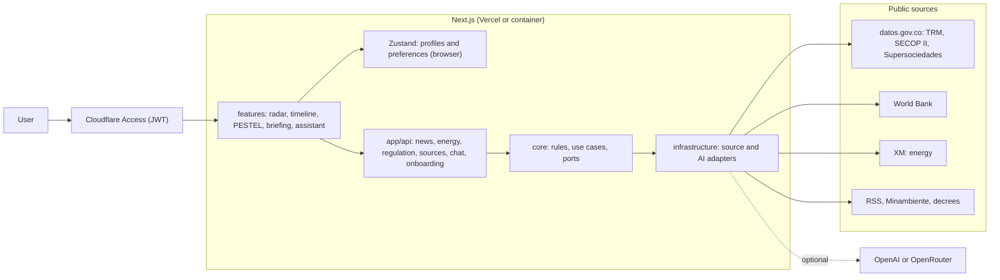
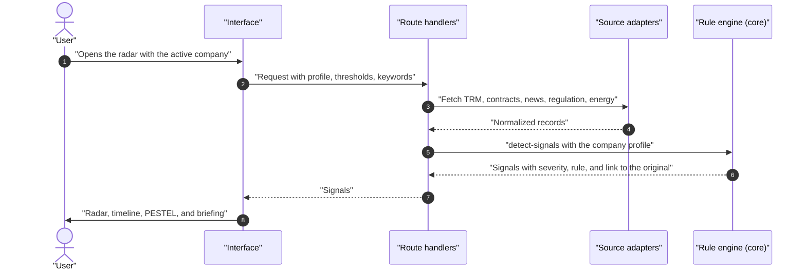
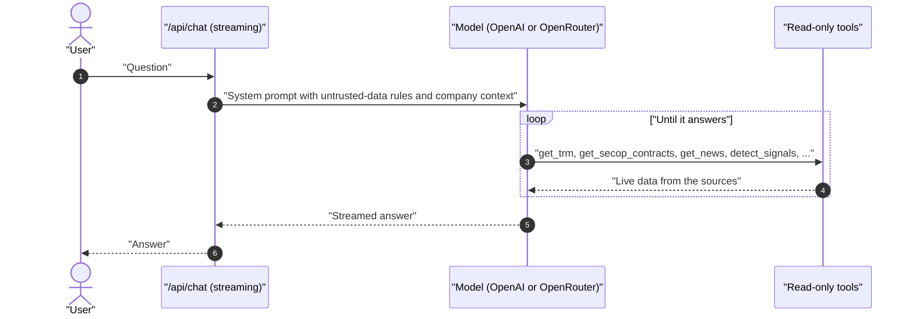

# Smart Work Core architecture

English | [Español](./architecture.md)

## Context

A Next.js application with no database. The browser stores company profiles; the server queries public sources, runs the rules, and responds. The AI assistant is optional.

## Main flow: from data to signal

## Assistant flow

## Folder structure

| Path | Purpose |
| ---- | ------- |
| `src/core/domain`, `rules` | Company model, signals, and pure rules: TRM, contract expiry, competitor contracts, energy, news, regulation, severity, and deduplication |
| `src/core/usecases` | `detect-signals`, `build-timeline`, `build-pestel`, `build-briefing`, and Markdown and CSV export |
| `src/core/ports` | Contracts: source, clock, logger, signal analyzer |
| `src/infrastructure/sources` | Adapters for datos.gov.co, World Bank, XM, RSS, regulation, and curated norms |
| `src/infrastructure/ai` | Model, system prompt, assistant tools, and guided onboarding |
| `src/app` | Next.js routes and route handlers (`api/chat`, `api/news`, `api/energia`, `api/regulacion`, `api/fuentes`, `api/onboarding`) |
| `src/features` | UI per feature |
| `src/proxy.ts` | Cloudflare Access JWT validation and the public path list |

## Key decisions

- **Framework-free core**: rules live in `core` and depend on ports, not on Next.js; architecture tests (`architecture.test.ts`) guard the boundaries.
- **No database**: profiles live in the browser and the server is a closed proxy to the sources.
- **Assistant with read-only tools**: it calls tools over live data instead of RAG. The prompt treats data as untrusted to mitigate instruction injection.
- **Swappable AI provider**: OpenAI or OpenRouter through `AI_PROVIDER`; without a key the rest of the app works.
- **Per-source switches**: `FEATURE_*` variables turn each source off.
- **Protected access**: only the landing page is public; everything else requires Cloudflare Access and the app validates the JWT (RS256) in `src/proxy.ts`, failing closed. See [`cloudflare-access.md`](./cloudflare-access.md) (Spanish).
- **Dual deployment**: Vercel and a container with `standalone` output. See [`deploy.md`](./deploy.md) (Spanish).
