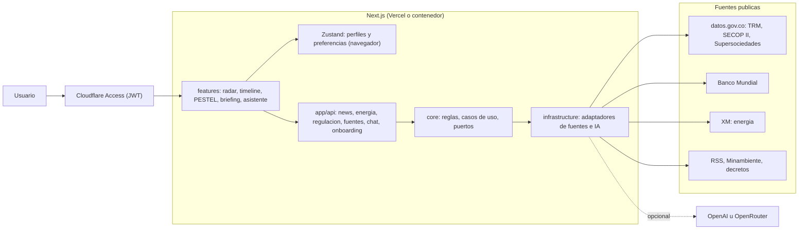
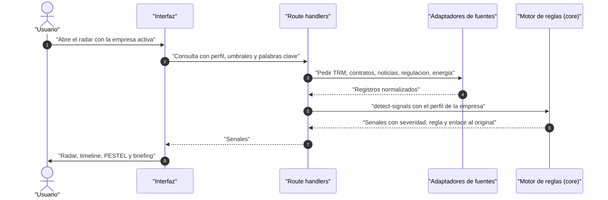
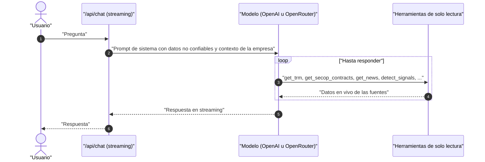

# Arquitectura de Smart Work Core

[English](./architecture.en.md) | Español

## Contexto

Una aplicación Next.js sin base de datos. El navegador guarda los perfiles de empresa; el servidor consulta fuentes públicas, ejecuta las reglas y responde. El asistente de IA es opcional.

## Flujo principal: del dato a la señal

## Flujo del asistente

## Estructura de carpetas

| Ruta | Propósito |
| ---- | --------- |
| `src/core/domain`, `rules` | Modelo de empresa, señales y reglas puras: TRM, vencimiento de contratos, contratos de competidores, energía, noticias, regulación, severidad y deduplicación |
| `src/core/usecases` | `detect-signals`, `build-timeline`, `build-pestel`, `build-briefing` y exportación a Markdown y CSV |
| `src/core/ports` | Contratos: fuente, reloj, logger, analizador de señales |
| `src/infrastructure/sources` | Adaptadores de datos.gov.co, Banco Mundial, XM, RSS, regulación y normas curadas |
| `src/infrastructure/ai` | Modelo, prompt de sistema, herramientas del asistente y onboarding guiado |
| `src/app` | Rutas de Next.js y route handlers (`api/chat`, `api/news`, `api/energia`, `api/regulacion`, `api/fuentes`, `api/onboarding`) |
| `src/features` | Interfaz por funcionalidad |
| `src/proxy.ts` | Validación del JWT de Cloudflare Access y lista de rutas públicas |

## Decisiones clave

- **Núcleo sin framework**: las reglas viven en `core` y dependen de puertos, no de Next.js; hay pruebas de arquitectura (`architecture.test.ts`) que protegen los límites.
- **Sin base de datos**: los perfiles viven en el navegador y el servidor es un proxy cerrado hacia las fuentes.
- **Asistente con herramientas de solo lectura**: llama herramientas sobre datos en vivo en lugar de RAG. El prompt trata los datos como no confiables para mitigar inyección de instrucciones.
- **Proveedor de IA intercambiable**: OpenAI u OpenRouter por `AI_PROVIDER`; sin clave el resto de la app funciona.
- **Interruptores por fuente**: variables `FEATURE_*` apagan cada fuente.
- **Acceso protegido**: solo el landing es público; el resto exige Cloudflare Access y la app valida el JWT (RS256) en `src/proxy.ts` y falla cerrada. Ver [`cloudflare-access.md`](./cloudflare-access.md).
- **Despliegue doble**: Vercel y un contenedor con salida `standalone`. Ver [`deploy.md`](./deploy.md).
