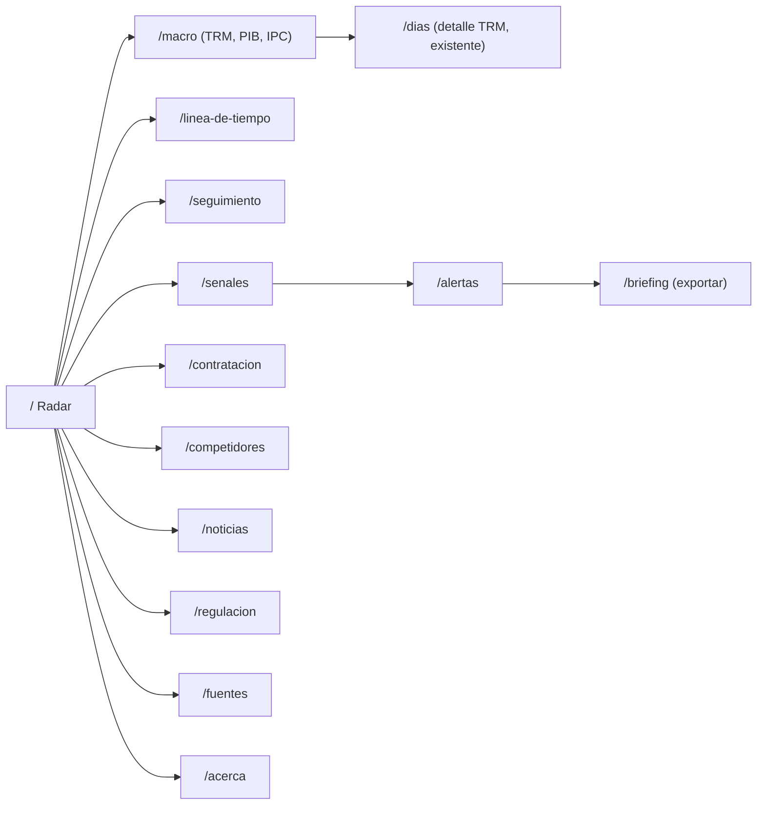
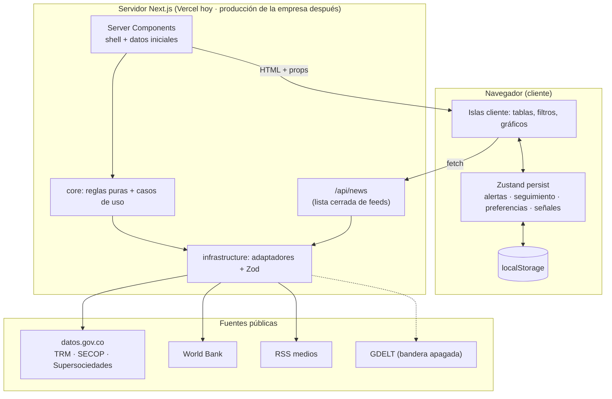
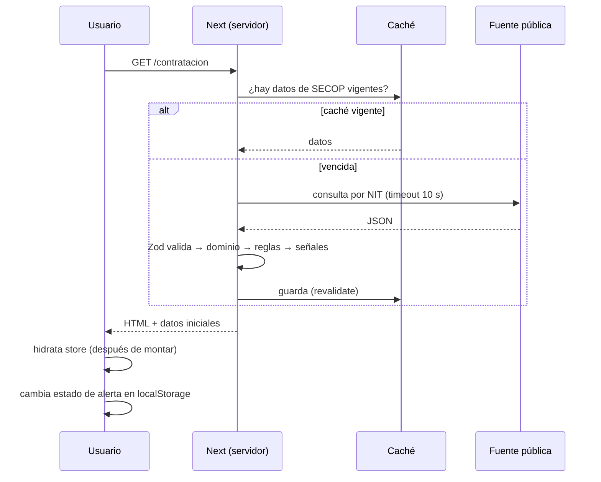

# Propuesta MVP — Centro de inteligencia del entorno (Smurfit Westrock Colombia)

Fecha: 2026-10-20 · Estado: **propuesta para aprobación** (no hay código escrito para esta propuesta) ·
Repositorio: el prototipo actual del monitor de TRM (Next.js 16).

> **Prototipo no oficial.** No tiene relación con Smurfit Westrock ni cuenta con su aval. Todo dato sale
> de fuentes públicas y lleva su enlace. Lo marcado **[no verificado]** debe confirmarse antes de usarse.

**Cómo leer este documento.** Cada sección tiene la explicación técnica y, cuando ayuda, una línea
**"En simple:"** con una analogía corta. Los estados de las decisiones son: **confirmado** (lo decidió el
usuario), **supuesto** (recomendación que se aplica mientras nadie diga lo contrario) y **pendiente**
(falta una respuesta del usuario; ver el Bloque 1 de preguntas al final).

Fuentes internas de esta propuesta (todas verificadas el 2026-10-20):

- [Fuentes de datos verificadas](../../research_notes/Propuesta%20MVP%20monitor%20entorno/fuentes_datos.md)
- [Estado del arte y similares](../../research_notes/Propuesta%20MVP%20monitor%20entorno/estado_arte_similares.md)
- [Arquitectura y stack](../../research_notes/Propuesta%20MVP%20monitor%20entorno/arquitectura_stack.md)
- [Informe de contexto de la empresa](../../reports/Smurfit%20Westrock%20Colombia%20Yumbo.md)
- [Guía de levantamiento de requerimientos](../requerimientos/guia-levantamiento.md)

---

## Índice

1. [Resumen ejecutivo](#1-resumen-ejecutivo)
2. [Resultado de la investigación](#2-resultado-de-la-investigación)
3. [Registro de decisiones](#3-registro-de-decisiones)
4. [Especificación del producto](#4-especificación-del-producto)
5. [Diseño funcional y navegación](#5-diseño-funcional-y-navegación)
6. [Arquitectura técnica](#6-arquitectura-técnica)
7. [Inventario de datos](#7-inventario-de-datos)
8. [Estructura del proyecto](#8-estructura-del-proyecto)
9. [Plan de ejecución de un día](#9-plan-de-ejecución-de-un-día)
10. [Plan de evolución](#10-plan-de-evolución)
11. [Instrucciones para construir con IA](#11-instrucciones-para-construir-con-ia)
12. [Métricas de éxito](#12-métricas-de-éxito)
13. [Bloque 1 de preguntas](#13-bloque-1-de-preguntas)

---

## 1. Resumen ejecutivo

**Qué se propone.** Convertir el monitor de TRM actual en un **centro de inteligencia del entorno**
para una sola empresa (Smurfit Westrock Colombia, papel y empaques): una **herramienta operativa**,
no una app de preguntas y respuestas ni un chat. Es un **radar/tablero de señales con datos reales**
que junta cinco dimensiones: **contratación pública, regulación, competidores, mercado/noticias y
macroeconomía**. Tiene **listas de seguimiento** (competidores por NIT, indicadores), **alertas por
reglas** con estados (nueva → revisada → descartada), una **línea de tiempo de eventos**,
**detalle hasta la procedencia** (cada dato muestra de dónde viene, cuándo se consultó y con qué
licencia) y un **informe/briefing exportable**. Unas **reglas explícitas** (por ejemplo "un contrato
vence en 90 días o menos") convierten los datos en **señales**.

**En simple:** es como un tablero de noticias del barrio para una sola tienda: te dice qué pasó con el
precio del dólar, qué contratos firmó la tienda vecina con el colegio y qué reglas nuevas puso la
alcaldía. Y te avisa con reglas claras ("si pasa X, te aviso"), no con adivinanzas.

**Por qué ahora y por qué así.**

- Ya hay un prototipo funcionando (TRM, Next.js 16, ReUI) que se puede ampliar sin reescribir.
- La investigación de hoy encontró **cuatro fuentes nuevas que funcionan en vivo y sin clave**:
  SECOP II por NIT de proveedor, Supersociedades (estados financieros de competidores), World Bank (PIB
  e inflación anual) y RSS de medios colombianos.
- Corrige dos conclusiones del README: **SECOP sí sirve** si se filtra por NIT del proveedor, y
  **GDELT sigue sin ser confiable** (429 persistente).

**Qué incluye el MVP de un día.** TRM (ya existe), contratos públicos de la empresa y de tres
competidores, ficha financiera de competidores, PIB/IPC anual, noticias por RSS (solo título, fuente,
fecha y enlace), una lista curada a mano de normas clave, señales por reglas, alertas con estados,
listas de seguimiento, línea de tiempo y briefing exportable. Sin login, sin base de datos, sin IA.
**Se desplegará en Vercel**; el destino final es el **entorno de producción propio de la empresa**,
por eso la arquitectura se mantiene portable (build estándar de Next.js).

**Qué queda para después.** IPC mensual del DANE, Banco de la República (endpoints no documentados),
GDELT, Google News (riesgo por sus términos de uso), resúmenes y clasificación con IA (detrás del
puerto, solo cuando la herramienta pruebe ser útil sin IA), notificaciones y cuentas de usuario.
**No habrá** consultas en lenguaje natural ni interfaz conversacional, ni en el MVP ni en la
evolución cercana.

**Decisiones abiertas** (ver Bloque 1 de preguntas): caso de uso principal (recomendado: **radar
semanal "¿qué cambió esta semana?"**), fuente de noticias, competidores a seguir, alcance de la
regulación curada, horizonte histórico y tono de los textos.

---

## 2. Resultado de la investigación

### 2.1 Estado del arte: qué marcos sirven en un día

| Marco | Qué es (en simple) | Uso en el MVP |
|---|---|---|
| PESTEL | Seis cajones para ordenar lo que pasa afuera: Político, Económico, Social, Tecnológico, Ambiental, Legal. | **Solo etiqueta** de cada señal y filtro. |
| Señales débiles (Ansoff 1975; Hiltunen 2008) | Pistas tempranas de un cambio, todavía sin confirmar. | **Solo el concepto**: campo `tipo` (evento / tendencia / señal débil). Sin detección automática (exige IA). Fuente: [Canada Horizons, módulo 3](https://horizons.service.canada.ca/en/our-work/learning-materials/foresight-training-manual-module-3-scanning/3/index.shtml). |
| Horizon scanning | Mirar el horizonte, anotar y clasificar lo que aparece. | **Solo la primera fase** (escanear + registrar + clasificar). Fuente: [USDA FS](https://research.fs.usda.gov/download/treesearch/44822.pdf). |
| Cinco fuerzas de Porter | Análisis de rivales, proveedores, compradores, sustitutos y entrantes. | Etiqueta opcional, no análisis completo. |
| Escenarios, Delphi | Talleres con expertos. | **No** (excesivo para el MVP). |

### 2.2 Productos similares: qué adaptar y qué no copiar

| Producto | Qué adaptar | Qué no copiar |
|---|---|---|
| [Feedly Market Intelligence](https://feedly.com/market-intelligence) | Cada tendencia enlaza a su evidencia. | Miles de fuentes genéricas sin curaduría local. |
| [Crayon](https://www.crayon.co/) | Idea de "importancia" de una señal (luego, con IA y explicada). | Battlecards y métricas de ventas SaaS. |
| [Klue](https://www.klue.com/) | Toda afirmación con cita a la fuente. | Win-loss y el asistente de preguntas ("Ask Klue"): el MVP no es conversacional. |
| [AlphaSense](https://www.alpha-sense.com/) | Citación fina (a la frase). | Contenido licenciado de alto costo. |
| [Signal AI](https://www.signal-ai.com/) | Bloque de "riesgos emergentes". | Modelo de contenido completo licenciado. |
| [Contify](https://www.contify.com/) | Línea de tiempo por competidor. | Servicio gestionado de analistas. |
| [Valora Analitik](https://www.valoraanalitik.com/?p=164426) | Fuente local para enlazar (titular + enlace). | Republicar su contenido. |
| [Datlas Colombia](https://www.bancoldex.com/en/node/4471) | Fuente territorial complementaria. | — |

No verificados: Meltwater (404), Owler (timeout), Valona (certificado vencido), EMIS, Bloomberg Línea,
GlobalNews en Colombia. **Brecha hipotética** (no verificada): no se halló un producto sectorial de
empaques/papel en Colombia con alertas de compras públicas y regulación.

### 2.3 Herramientas de código abierto

Conclusión práctica: **ninguna se usa tal cual en el MVP**, porque todas necesitan servidor y base de
datos. Se reutiliza la idea.

| Proyecto | Licencia | Idea reutilizable |
|---|---|---|
| [Huginn](https://github.com/huginn/huginn) | MIT | Agentes con reglas que vigilan fuentes. |
| [changedetection.io](https://github.com/dgtlmoon/changedetection.io) | Apache-2.0 | Vigilar cambios en páginas regulatorias (iteración futura). |
| [Miniflux](https://github.com/miniflux/v2) / [FreshRSS](https://github.com/FreshRSS/FreshRSS) | Apache-2.0 / AGPL-3.0 | Agregador RSS propio si crecen las fuentes. |
| [Evidence](https://github.com/evidence-dev/evidence) | MIT | "BI como código". |
| [OpenBB](https://github.com/OpenBB-finance/OpenBB) | Apache-2.0 | Inspiración de terminal financiera. |
| [n8n](https://github.com/n8n-io/n8n) | Sustainable Use (no OSI) | Orquestador interno futuro; no embebido. |
| Superset, Metabase, Grafana | Apache / AGPL | Inspiración de tableros; requieren servidor. |

### 2.4 Fuentes públicas y APIs viables (verificadas en vivo hoy)

| Fuente | Estado | Uso día 1 |
|---|---|---|
| datos.gov.co TRM `mcec-87by` | Funciona en navegador (CORS `*`) | Sí (ya en uso) |
| SECOP II contratos `jbjy-vk9h` por NIT | Funciona (0,4–5 s con filtros exactos) | **Sí** |
| SECOP II procesos `p6dx-8zbt` | Funciona | Opcional (oportunidades abiertas) |
| Supersociedades `6cat-2gcs` | Funciona | **Sí** (ficha financiera) |
| World Bank PIB e IPC anual | Funciona (CORS `*`) | **Sí** |
| RSS Portafolio, La República, El Tiempo, Valora | Funciona solo vía servidor (sin CORS) | **Sí**, vía proxy |
| RSS El Colombiano negocios | Funciona en navegador (CORS `*`) | Sí, por el mismo proxy |
| Banco de la República SUAMECA | Funciona, pero **no documentado** | Experimental, apagado |
| DANE IPC (xlsx) | Solo vía servidor; sin API | Siguiente iteración |
| Google News RSS | Solo vía servidor; términos "uso personal no comercial" | **Pendiente** |
| GDELT DOC API | **No confiable** (429) | Detrás de bandera, apagado |
| SUIN-Juriscol, Diario Oficial | Sin API/feed | No (enlace manual) |

### 2.5 Limitaciones de la investigación

- Una sola medición por URL, desde una IP residencial en Cali; CORS simulado con cabecera `Origin`,
  no desde un navegador real.
- Términos de uso no leídos completos para DANE, Banco de la República, World Bank y GDELT. Solo se
  leyó la licencia de datos.gov.co (vía API) y el aviso de Google News.
- SECOP II cubre **solo compra pública**: es una señal de nicho (licoreras departamentales y
  similares), no el mercado total de la empresa, que es mayormente privado.
- Supersociedades no declara la unidad de sus cifras (parece billones de COP; deducir con cautela).
- No hay asesoría legal; las precauciones de derechos de autor y marca son prudenciales.

### 2.6 Contradicciones encontradas y cómo se resuelven

| # | Tema | Evidencia A | Evidencia B | Resolución |
|---|---|---|---|---|
| C1 | **GDELT** | Arquitectura: primera llamada 429, tras 20 s de espera **200** con `Cache-Control: max-age=900`. | Fuentes: **429 en todos los intentos**, también tras 20 s y desde otra IP (`r.jina.ai`). | GDELT es **no confiable**: solo detrás del proxy del servidor, con caché, **bandera apagada** por defecto y **nunca como única fuente** de noticias. |
| C2 | **SECOP** | README: "no es señal útil" (búsqueda por categoría UNSPSC). | Fuentes: por **NIT del proveedor** hay contratos reales de la empresa y competidores con licoreras. | Se usa **SECOP por NIT** el día 1. Se prohíben consultas `LIKE` (12–48 s). **Resuelto en documentos:** README y guía de levantamiento corregidos (2026-10-20). |
| C3 | Google News | Estado del arte: términos no hallados [no verificado]. | Fuentes: el propio feed dice "personal, non-commercial use". | Riesgo legal de **la fuente** (no del hosting) **verificado**: una herramienta operativa de empresa no encaja en "uso personal". Apagado por bandera; decisión en la pregunta 2. |
| C4 | IPC en datos.gov.co | README: "sumar IPC de datos.gov.co". | Fuentes: el catálogo no tiene IPC nacional vigente. | IPC anual por World Bank el día 1; IPC mensual DANE en la siguiente iteración. |
| C5 | NIT de la empresa | Informe de contexto: NIT "no encontrado". | Supersociedades y SECOP: **Cartón de Colombia S.A., NIT 890300406**. | Se usa 890300406 (razón social Cartón de Colombia; "Smurfit Westrock" no aparece como nombre). |
| C6 | Ingresos 2025 | Informe de gestión: ventas netas consolidadas COP 1,742 billones. | Supersociedades: ingresos operacionales "1,91" (unidad no declarada). | Son cifras distintas (alcance y definición). La app muestra la cifra de Supersociedades **con su etiqueta y fuente**, sin mezclarlas. |
| C7 | Atribución TRM | README: "Banco de la República publicado como dato abierto". | API de datos.gov.co: atribución **Superfinanciera**, CC BY-SA 4.0. | Pie de tarjeta: "Superfinanciera vía datos.gov.co". **Resuelto:** README corregido y atribución confirmada en vivo (2026-10-20). |
| C8 | Login | README: "sin login". | `odd/tasks/nextjs-migration.md` aún menciona `/login`. | **Resuelto:** el código ya no tiene ruta de login; el feature doc quedó marcado como "Superseded decision" (2026-10-20). |
| C9 | Dataset TRM | Estado del arte: id `32sa-8pi3` [no verificado]. | En uso y verificado: `mcec-87by`. | Se mantiene `mcec-87by`. **Verificado en vivo (2026-10-20):** ambos ids existen y los dos son de la Superfinanciera; `32sa-8pi3` es el dataset base ("TRM") y `mcec-87by` es una vista filtrada ("TRM Histórico"), la que usa la app. |

### 2.7 Referencias

- Socrata SODA: https://dev.socrata.com/docs/endpoints.html · tokens: https://dev.socrata.com/docs/app-tokens.html
- Licencia CC BY-SA 4.0: https://creativecommons.org/licenses/by-sa/4.0/legalcode
- GDELT: https://www.gdeltproject.org/about.html · https://blog.gdeltproject.org/gdelt-doc-2-0-api-debuts/
- DANE IPC: https://www.dane.gov.co/index.php/estadisticas-por-tema/precios-y-costos/indice-de-precios-al-consumidor-ipc
- Banco de la República SUAMECA: https://suameca.banrep.gov.co/estadisticas-economicas/
- World Bank licencias: https://datacatalog.worldbank.org/public-licenses
- Vercel: https://vercel.com/docs/limits · https://vercel.com/docs/cron-jobs/usage-and-pricing
- Next.js: https://nextjs.org/docs/app/getting-started/caching · https://nextjs.org/docs/app/guides/content-security-policy · https://nextjs.org/docs/app/guides/testing/vitest
- Zustand persist: https://zustand.docs.pmnd.rs/reference/integrations/persisting-store-data
- TanStack Start: https://tanstack.com/start/latest/docs/framework/react/overview
- Ley 1581 (vía concepto SIC): https://sedeelectronica.sic.gov.co/sites/default/files/normatividad/Concepto_13-230237.pdf
- ReUI: https://reui.io/components/

---

## 3. Registro de decisiones

| ID | Tema | Decisión | Estado | Justificación | Alternativas | Impacto |
|---|---|---|---|---|---|---|
| D01 | Piloto | Smurfit Westrock Colombia; foco en inteligencia de mercado, compra pública, regulación, competidores, economía. | confirmado | Decisión del usuario. | Otra empresa; varias. | Define fuentes y NIT. |
| D02 | Tenencia | Una sola empresa, sin multi-tenancy. | confirmado | Simplicidad. | Multiempresa. | Configuración fija en código. |
| D03 | Audiencia | Público general; SPA pública. | confirmado | Decisión del usuario. | Equipo interno con login. | Sin datos sensibles; las señales dicen "qué mirar", no órdenes a la empresa. |
| D03b | Tipo de producto | Herramienta operativa (radar de señales, listas de seguimiento, alertas con estados, línea de tiempo, briefing exportable). **No** es app de preguntas y respuestas ni chat; sin consultas en lenguaje natural en el MVP ni en la evolución cercana. | confirmado | Decisión del usuario. | Asistente conversacional. | Cada pantalla responde una pregunta de negocio con datos, no con texto generado. |
| D04 | Alcance | Todas las dimensiones; UI modular con ReUI. | confirmado | Decisión del usuario. | Una sola dimensión. | Cinco módulos. |
| D05 | Fuentes difíciles | Si DANE/Banco de la República no entran en vivo, se documentan. Prioridad: datos.gov.co + GDELT. | confirmado | Decisión del usuario. | — | GDELT queda con bandera (ver D12). |
| D06 | Autenticación | Sin login. | confirmado | Decisión del usuario. | Auth básica. | Nada personal en servidor. |
| D07 | Persistencia | Zustand + `persist` en localStorage; sin backend ni BD. | confirmado | Decisión del usuario. | BD, KV. | Datos solo en cada navegador. |
| D08 | IA | Sin IA; puertos desacoplados para el futuro; sin llaves en el cliente. | confirmado | Probar utilidad sin IA primero. | IA desde el día 1. | Puerto `SignalAnalyzer` con `Noop`. |
| D09 | Despliegue | Se despliega en Vercel; destino final: entorno de producción propio de la empresa. Arquitectura portable; pasos de despliegue documentados. | confirmado | Decisión del usuario. | Solo Vercel; solo infraestructura propia. | Build estándar `next build`/`next start`; nada exclusivo de Vercel en el dominio (sección 6.9). |
| D10 | Proceso | TDD + ODD (feature doc, tarea a tarea, RED→GREEN→refactor, commits por unidad). | confirmado | Decisión del usuario. | — | T1 agrega runner de pruebas. |
| D11 | Renderizado | Next.js 16 híbrido (shell en servidor + fetch con caché + islas cliente). | supuesto | Repo ya en Next; necesitamos un proxy mínimo. | Vite SPA; TanStack Start. | Sin migración. |
| D12 | GDELT | Solo detrás del proxy, con caché, bandera **apagada**, nunca fuente única. | supuesto | C1: no confiable. | Usarlo como fuente principal. | Noticias no dependen de GDELT. |
| D13 | Noticias | RSS de medios colombianos vía proxy; mostrar solo título, fuente, fecha y enlace. | supuesto | Funciona hoy; precaución de derechos de autor. | Google News; GDELT. | Cobertura general, se filtra por palabra clave. |
| D14 | Google News RSS | Usarlo o no. | **pendiente** | Riesgo de términos de la fuente: "personal, no comercial". | RSS de medios. | Bandera apagada; ver pregunta 2. |
| D15 | Contratación pública | SECOP II contratos filtrados por NIT; sin `LIKE`. | supuesto | C2: señal real con latencia < 1 s. | UNSPSC; texto libre. | Señal de nicho (licoreras). |
| D16 | Competidores | Cartones América (860026759), Carvajal Empaques (890319047), Papeles y Cartones (890925108). | supuesto | NIT verificados en SECOP y Supersociedades. | Lista propia. | Ver pregunta 3. |
| D17 | Finanzas de competidores | Supersociedades `6cat-2gcs`. | supuesto | Verificado; foto anual por empresa. | Estados NIIF (iteración 2). | Unidad no declarada: etiquetar. |
| D18 | Macro | TRM + World Bank PIB/IPC anual el día 1; SUAMECA experimental apagado; DANE IPC en siguiente iteración. | supuesto (aplica D05) | Lo verificado entra; lo no documentado espera. | SUAMECA en vivo. | Inflación solo anual el día 1. |
| D19 | Regulación | JSON curado a mano en el repo con normas reales y enlaces, rotulado "curado manualmente". | supuesto | No hay API/feed útil. | Scraping; feed Minambiente. | No es dato en vivo; se dice en pantalla. |
| D20 | Datos de demo | Prohibido presentar datos simulados como reales; toda demo se rotula. | supuesto | Confianza. | — | Fixtures solo en pruebas. |
| D21 | Señales | Reglas explícitas con ID y versión; PESTEL solo como etiqueta; sin puntajes opacos. | supuesto | Explicable y testeable. | Puntaje con IA. | Cada señal muestra regla, fuente, fecha, licencia. |
| D22 | Validación y red | Zod 4 en cada respuesta externa; `fetch` nativo con envoltura propia; date-fns. | supuesto | Hoy `api.ts` confía ciegamente. | ky; Temporal. | Errores tipados. |
| D23 | Pruebas | Vitest + Testing Library + MSW con fixtures grabados; Playwright solo humo. | supuesto | Hoy no hay runner. | Jest. | T1 del plan. |
| D25 | Marca | Disclaimer "prototipo no oficial / sin aval"; sin logos. | supuesto | Precaución de marca. | Pedir autorización escrita. | Footer visible. |
| D26 | Analítica de uso | Sin analítica el día 1. | **pendiente** | Ley 1581 y métricas de uso. | Analítica sin cookies. | Métricas de uso no medibles aún (sección 12). |
| D27 | Retención local | Guardar señales de los últimos 90 días y máximo 500 alertas. | supuesto | localStorage ~5 MB por origen. | Sin límite. | `partialize` en el store. |
| D28 | CSP | CSP por cabeceras sin nonce (`'unsafe-inline'`), primero en modo Report-Only. | supuesto | El nonce obliga a render dinámico y quita el prerender. | CSP con nonce; SRI experimental. | Mantiene shell estático. |
| D29 | Documentación | Corregir README (C2, C4, C7) y limpiar `/login` del feature doc (C8). | supuesto | Coherencia. | — | Tarea T0. |

### 3.1 Decisiones técnicas principales (formato completo)

#### DT-1 Estrategia de renderizado: SPA + SSR combinados

- **Problema.** Hoy todo se pide desde el navegador: la primera pantalla sale vacía (solo esqueleto) y
  no hay dónde esconder un proxy para fuentes sin CORS (RSS) o con límite de tasa (GDELT).
- **Alternativas.** (a) Next.js 16 híbrido; (b) Vite SPA + TanStack Router; (c) TanStack Start.
- **Recomendación.** (a) Next.js 16 App Router híbrido.
- **Razón.** El repo ya está en Next; da servidor mínimo (Route Handlers y caché) sin infraestructura
  extra; Vercel lo soporta nativo (`vercel.json` ya dice `framework: nextjs`).
- **Costo y limitaciones.** La caché por defecto es por instancia y efímera en serverless; un store de
  Zustand **nunca** debe leerse en el servidor.
- **Riesgo.** Activar `cacheComponents` en un repo existente exige revisar `Date.now()` y Suspense.
  Mitigación: empezar con `fetch(..., { next: { revalidate } })` y hacer un spike de 1 h después.
- **Versión MVP.** Shell en servidor, fetch con `revalidate`, un Route Handler `/api/news`, islas
  cliente para tablas, gráficos, filtros y alertas.
- **Evolución.** `cacheComponents` + `use cache`/`cacheTag`; caché remota si hay varias instancias.

**SPA no es lo mismo que SSR.** Una **SPA** (aplicación de una sola página) es una app que cambia de
pantalla sin recargar la página entera. **SSR** (renderizado en servidor) significa que el servidor
arma el HTML antes de enviarlo. No son opuestos: Next.js hace las dos cosas. La primera visita llega
armada desde el servidor (rápida y con datos), y después la navegación entre pantallas se siente como
una SPA (sin recargar).

**En simple:** en un restaurante, la cocina (servidor) prepara el plato y lo trae listo; en la mesa
(navegador) tú le pones sal, lo partes y pides más (interacción). Next.js tiene cocina y mesa.

#### DT-2 Persistencia local

- **Problema.** Las alertas viven en un hook propio sobre localStorage que guarda solo `string[]`
  (clave `smurfit-trm:alertas`); no se pueden guardar señales completas, notas ni preferencias.
- **Alternativas.** (a) Zustand 5 + `persist`; (b) seguir con el hook actual; (c) IndexedDB.
- **Recomendación.** (a) Zustand 5 + `persist` (decisión D07 confirmada).
- **Razón.** API pequeña con `version`, `migrate`, `partialize` y `skipHydration`.
- **Costo y limitaciones.** Los datos viven solo en ese navegador: si el usuario cambia de equipo,
  los pierde. No hay respaldo.
- **Riesgo.** Error de hidratación (el HTML del servidor no conoce el estado guardado). Mitigación:
  `skipHydration: true` y `persist.rehydrate()` en un `<StoreHydrator/>` después de montar.
  **Migración**: la clave antigua es distinta, así que `migrate` de Zustand no la ve; hace falta una
  importación única que lea `smurfit-trm:alertas`, la convierta a `Alert` y la borre.
- **Versión MVP.** Tres stores: `alerts`, `preferences`, `signals` (cache local de señales vistas).
- **Evolución.** Exportar/importar JSON; sincronización con backend si un día hay login.

**En simple:** localStorage es una libreta guardada dentro de tu navegador. Zustand es el
bibliotecario que sabe en qué página escribir y cómo pasar las notas viejas a la libreta nueva.

#### DT-3 Fuente de noticias

- **Problema.** Necesitamos menciones de la empresa, competidores y sector, sin clave y sin violar
  derechos de autor.
- **Alternativas.** (a) RSS de medios colombianos vía proxy; (b) Google News RSS vía proxy;
  (c) GDELT DOC API.
- **Recomendación.** (a) como fuente principal; (c) con bandera apagada; (b) pendiente.
- **Razón.** (a) respondió 200 hoy en todos los feeds probados; (b) tiene restricción de términos;
  (c) devolvió 429 de forma persistente.
- **Costo y limitaciones.** Los feeds de medios son generales: hay que filtrar por palabras clave
  (cartón, papel, empaque, reciclaje, Smurfit, REP, arancel, TRM) y habrá poco volumen y algo de ruido.
- **Riesgo.** Un medio cambia su URL de feed. Mitigación: cada feed falla aislado y la pantalla
  Fuentes lo muestra.
- **Versión MVP.** `/api/news` con lista cerrada de feeds, caché 30–60 min, solo título, fuente, fecha
  y enlace.
- **Evolución.** Google News si se aprueba; GDELT GKG como ETL; agregador propio (Miniflux).

#### DT-4 Contratación pública y competidores

- **Problema.** Buscar "cartón" en SECOP con `LIKE` tarda 12–48 s y la categoría UNSPSC mezcla
  estibas, vidrio y tapas.
- **Alternativas.** (a) Filtrar por NIT del proveedor; (b) por UNSPSC; (c) texto libre.
- **Recomendación.** (a) NIT del proveedor: `documento_proveedor in (...)` + `fecha_de_firma`.
- **Razón.** Respuesta < 1 s y resultados reales (ver ejemplo trabajado, sección 4.8).
- **Costo y limitaciones.** Solo ve compra pública; no ve contratos de competidores no listados.
- **Riesgo.** Límite por IP sin token de Socrata. Mitigación: consultar desde el servidor con caché
  (todos los visitantes comparten una consulta) y token opcional solo en servidor.
- **Versión MVP.** 4 NIT fijos (empresa + 3 competidores), ventana de 12 meses + historial de la empresa.
- **Evolución.** SECOP procesos para oportunidades abiertas; lista de competidores configurable.

#### DT-5 Macroeconomía

- **Problema.** IPC mensual y tasa de política no tienen API oficial documentada.
- **Alternativas.** (a) TRM + World Bank anual; (b) SUAMECA no documentado; (c) DANE xlsx vía servidor.
- **Recomendación.** (a) el día 1; (b) experimental apagado; (c) siguiente iteración.
- **Razón.** Solo lo documentado y estable entra al día 1 (D05).
- **Costo y limitaciones.** World Bank es anual y con ~1 año de rezago: sirve de contexto, no de alerta.
- **Riesgo.** Bajo.
- **Versión MVP.** TRM diaria con regla de variación; PIB e IPC anual en tarjetas.
- **Evolución.** `/api/ipc` que baja el xlsx del DANE una vez al día; tasa de política del Banco de la
  República cuando haya API oficial.

#### DT-6 Regulación

- **Problema.** No hay API ni feed útil (SUIN-Juriscol es una SPA vacía, Diario Oficial no conectó,
  `88h2-dykw` no tiene filtro temático útil).
- **Alternativas.** (a) JSON curado en el repo; (b) feed de Minambiente vía proxy; (c) scraping.
- **Recomendación.** (a).
- **Razón.** Es verdad verificable y barata; se rotula como curada.
- **Costo y limitaciones.** No se actualiza sola; requiere revisión manual.
- **Riesgo.** Que se lea como dato en vivo. Mitigación: etiqueta "Curado manualmente · revisado el
  <fecha>" en cada ficha.
- **Versión MVP.** 4–6 normas con enlace y fecha de revisión.
- **Evolución.** Feed de Minambiente; vigilancia de cambios en páginas (idea de changedetection.io).

#### DT-7 Señales y alertas

- **Problema.** Convertir datos en avisos útiles sin cajas negras.
- **Alternativas.** (a) Reglas explícitas versionadas; (b) puntaje estadístico; (c) IA.
- **Recomendación.** (a).
- **Razón.** Explicables, testeables con TDD y sin costo.
- **Costo y limitaciones.** Solo detectan lo que alguien previó.
- **Riesgo.** Demasiadas señales (ruido). Mitigación: umbrales conservadores y deduplicación por ID
  determinista.
- **Versión MVP.** 5 reglas (sección 4.6).
- **Evolución.** IA solo para resumir y explicar, nunca para crear ni borrar señales.

#### DT-8 Calidad: validación y pruebas

- **Problema.** No hay runner de pruebas y las respuestas externas no se validan.
- **Alternativas.** Vitest vs Jest; Zod vs validación manual; MSW vs `fetch` inyectado.
- **Recomendación.** Vitest + Testing Library + MSW + fixtures grabados; Zod 4; Playwright de humo.
- **Razón.** Guía oficial de Next con Vitest; Zod da tipos a partir del esquema.
- **Costo y limitaciones.** Vitest no prueba Server Components `async`: para esos, Playwright.
- **Riesgo.** Compatibilidad MSW 3 / Vitest 5 / Node 24 [no verificado]. Mitigación: prueba de humo en T1.
- **Versión MVP.** Pruebas de reglas puras, adaptadores con fixtures, stores y un E2E.
- **Evolución.** Contract tests `@live` semanales fuera del CI.

#### DT-9 IA futura

- **Problema.** Dejar lugar para IA sin acoplar el dominio a un proveedor.
- **Alternativas.** (a) Puerto + `NoopSignalAnalyzer`; (b) integrar Vercel AI SDK ya.
- **Recomendación.** (a) (D08 confirmada).
- **Razón.** La IA se implementa solo cuando la app pruebe ser útil sin ella, y solo para **resumir y
  clasificar** señales detrás del puerto. **No** se contempla consulta en lenguaje natural ni chat.
- **Costo y limitaciones.** Ninguno hoy.
- **Riesgo.** Inyección de instrucciones (prompt injection) en titulares, el día que llegue la IA.
  Mitigación documentada: separar `facts` (nuestros) de `untrustedText` (titulares), salida con
  esquema, sin herramientas, la IA no cambia severidad.
- **Versión MVP.** Interfaces + `Noop`; la UI no muestra nada si no hay análisis.
- **Evolución.** `AiSdkSignalAnalyzer` en `infrastructure/ai/` con llave solo en servidor.

#### DT-10 Despliegue portable (Vercel ahora, producción de la empresa después)

- **Problema.** El MVP se despliega en Vercel, pero su destino final es el entorno de producción propio
  de la empresa. No queremos rehacer nada al mudarnos.
- **Alternativas.** (a) Next.js estándar sin APIs exclusivas de Vercel; (b) usar servicios propios de
  Vercel (KV, Edge Config, Cron, AI Gateway) desde el dominio.
- **Recomendación.** (a).
- **Razón.** `next build` + `next start` (o la salida `output: "standalone"` en un contenedor) corre en
  cualquier servidor Node 24; la caché `revalidate` y los Route Handlers son de Next, no de Vercel.
- **Costo y limitaciones.** En Vercel: logs de runtime con retención corta y cron limitado según el
  plan. En la empresa: hay que proveer Node 24, HTTPS, salida a internet hacia las fuentes y,
  si hay varias instancias, una caché compartida.
- **Riesgo.** Que se cuele dependencia de Vercel (por ejemplo `@vercel/*` en el dominio). Mitigación:
  todo servicio de plataforma va detrás de un puerto (`Logger`, futura caché) en `infrastructure/`.
- **Versión MVP.** Despliegue en Vercel + checklist de despliegue y de mudanza (sección 6.9).
- **Evolución.** Contenedor en la infraestructura de la empresa; caché remota (cache handler) si hay
  varias instancias.

**En simple:** armamos la casa con piezas estándar de Lego, no con piezas que solo existen en una
tienda; así se puede desarmar y volver a armar en otro lugar.

### 3.2 Matriz comparativa de tecnologías (solo alternativas que vale la pena comparar)

| Tema | Opción | Ajuste al repo | Costo | Riesgo | Veredicto |
|---|---|---|---|---|---|
| Renderizado | **Next.js 16 híbrido** | Máximo (ya existe) | 0 | Bajo | **Elegido** |
| | Vite SPA + TanStack Router | Reescribir rutas | 0 + proxy aparte | Medio | No |
| | TanStack Start | Reescribir rutas y servidor | 0 | Medio-alto | No |
| Estado local | **Zustand 5 + persist** | Reemplaza hook propio | 0 | Bajo (hidratación) | **Elegido** |
| | Hook actual `useSyncExternalStore` | Ya existe | 0 | No escala a objetos | No |
| Datos en cliente | TanStack Query (rol reducido) | Ya existe | 0 | Doble caché si se abusa | Mantener solo para refresco |
| Noticias | **RSS medios vía proxy** | Route Handler | 0 | Bajo | **Elegido** |
| | Google News RSS | Route Handler | 0 | Términos | Pendiente |
| | GDELT DOC | Route Handler | 0 | 429 | Bandera apagada |
| Validación | **Zod 4** | Nuevo | 0 | Bajo | **Elegido** |
| | Validación manual | — | 0 | Errores silenciosos | No |
| Pruebas | **Vitest** | Guía oficial Next | 0 | Bajo | **Elegido** |
| | Jest | Más configuración | 0 | Medio | No |
| Gráficos | **Recharts** | Ya existe | 0 | Bajo | **Mantener** |
| | ECharts / visx | Cambio | 0 | Medio | Solo si >10k puntos |

**Combinación final recomendada:** Next.js 16 (App Router, híbrido) + React 19 + TypeScript +
Tailwind v4 + ReUI/shadcn + Zustand 5 `persist` + Zod 4 + `fetch` nativo + date-fns + Recharts +
TanStack Table (vía data-grid de ReUI) + Vitest + Testing Library + MSW + Playwright, con un puerto de
IA en modo `Noop`. Todo MIT/Apache-2.0, costo de bibliotecas 0 USD.

---

## 4. Especificación del producto

### 4.1 Problema

La información del entorno de la empresa está dispersa en silos: el dólar en un portal, los contratos
públicos en otro, las finanzas de competidores en otro y las normas en PDF. Nadie la junta, nadie
dice qué cambió y nadie deja rastro de dónde salió cada dato.

**En simple:** es como tener las piezas de un rompecabezas en cinco cajas distintas. La app las pone
en una sola mesa y te muestra cuáles piezas son nuevas.

### 4.2 Usuarios

| Usuario | Necesidad | Estado |
|---|---|---|
| Público general (principal) | Vigilar el entorno de una empresa colombiana de empaques con datos reales y fuentes claras. | confirmado |
| Equipo de la empresa (destino final en su producción) | Revisar señales, marcar alertas, seguir competidores e indicadores, exportar un briefing. | supuesto (sin login hoy) |

**Tensión registrada.** Una app pública no puede ordenar decisiones internas de la empresa. Por eso
las señales se redactan como **"qué mirar"** ("vence en 72 días; revisar si hay proceso nuevo"), no
como instrucciones ("renueve el contrato"). Cuando la app pase a la producción de la empresa, se
podrá revisar este tono.

### 4.3 Caso de uso prioritario (recomendado, pendiente pregunta 1)

**Radar semanal: "¿qué cambió esta semana?"** Un usuario abre el tablero y en menos de un minuto ve
las señales nuevas de los últimos 7 días en las cinco dimensiones, cada una con su regla, fuente y
fecha. Las revisa (nueva → revisada o descartada), baja al dato original cuando lo necesita y exporta
el briefing de la semana.

La app **no** responde preguntas escritas ni tiene chat: la "pregunta de negocio" de cada pantalla es
el propósito de su diseño, y la respuesta son datos con procedencia.

### 4.4 Funcionalidades

1. **Radar** (inicio): señales nuevas de la semana, contadores por dimensión y severidad.
2. **Línea de tiempo** de eventos: contratos, noticias, normas y movimientos de indicadores en orden.
3. **Detalle con procedencia**: de cada señal al registro original (regla, evidencia, URL, licencia).
4. **Listas de seguimiento**: competidores por NIT e indicadores (TRM, PIB, IPC) que el usuario sigue.
5. Macro: TRM (existente), PIB e IPC anual.
6. Contratación pública: contratos de la empresa y competidores (SECOP II por NIT).
7. Competidores: ficha financiera (Supersociedades) + contratos públicos.
8. Noticias: titulares filtrados por palabras clave desde RSS de medios.
9. Regulación: lista curada a mano de normas clave.
10. **Alertas por reglas con estados**: nueva → revisada → descartada, con nota (local).
11. **Briefing exportable**: resumen semanal generado por plantilla (no por IA) en Markdown/HTML
    imprimible y CSV.
12. Fuentes: estado de cada fuente (último éxito, error, licencia).
13. Acerca de: metodología, reglas, disclaimer.

### 4.5 Requisitos funcionales

| ID | Requisito |
|---|---|
| RF-01 | Mostrar la TRM vigente, su variación diaria y el histórico (comportamiento actual). |
| RF-02 | Mostrar contratos SECOP II firmados en los últimos 12 meses por los NIT configurados, con entidad, valor, fechas, estado y enlace al proceso. |
| RF-03 | Mostrar la ficha financiera anual (ingresos, utilidad, activos, año de corte) de la empresa y los competidores desde Supersociedades. |
| RF-04 | Mostrar PIB real e IPC anual de Colombia (World Bank) con año y fecha de actualización. |
| RF-05 | Mostrar titulares de RSS de medios filtrados por palabras clave: solo título, medio, fecha y enlace. |
| RF-06 | Mostrar normas curadas con número, fecha, tema, por qué importa, enlace y fecha de revisión. |
| RF-07 | Generar señales a partir de reglas explícitas (sección 4.6), cada una con regla, fuente, fecha, licencia y etiqueta PESTEL. |
| RF-08 | Filtrar señales por dimensión, PESTEL, severidad y rango de fechas. |
| RF-09 | Cada señal disparada crea una alerta en estado **nueva**; el usuario la pasa a **revisada** o **descartada**, con nota opcional; persiste en el navegador. |
| RF-10 | Migrar las alertas antiguas (`smurfit-trm:alertas`) al nuevo formato sin perderlas. |
| RF-11 | Mostrar el estado de salud de cada fuente y marcar "dato desactualizado" cuando corresponda. |
| RF-12 | Exportar a CSV la tabla visible (comportamiento actual extendido a contratos, señales y alertas). |
| RF-13 | Mostrar en el pie de cada tarjeta la fuente, la fecha de consulta y la licencia. |
| RF-14 | Mostrar el disclaimer "prototipo no oficial, sin aval" en todas las pantallas. |
| RF-15 | Listas de seguimiento: agregar o quitar competidores (de la lista de NIT configurados) e indicadores; el radar y la línea de tiempo se filtran por ellas. |
| RF-16 | Línea de tiempo de eventos de todas las dimensiones, ordenada por fecha, con filtro por dimensión y lista de seguimiento. |
| RF-17 | Briefing exportable del período elegido: señales por dimensión, alertas y su estado, cada ítem con fuente y enlace; generado por plantilla, sin IA. |
| RF-18 | Detalle de señal: regla legible, evidencia, registro original (campos clave) y enlace a la fuente. |

### 4.6 Reglas de señal del MVP

| ID de regla | Dimensión | Regla | PESTEL | Severidad |
|---|---|---|---|---|
| `trm.daily-move.v1` | Macro | Variación diaria de la TRM ≥ 1 % (umbral actual). | Económico | watch; alert si ≥ 2 % |
| `secop.expiring-contract.v1` | Contratación | Contrato de la empresa con fin ≤ 90 días y estado ≠ terminado. | Económico | watch |
| `secop.competitor-new-contract.v1` | Competidores | Un competidor configurado firma un contrato nuevo (fecha de firma en los últimos 30 días). | Económico | watch |
| `news.keyword-mention.v1` | Mercado | Titular nuevo (últimos 7 días) que menciona a la empresa o a un competidor. | Social | info |
| `trm.30d-move.v1` | Macro | La TRM sube > 3 % en 30 días (sube un nivel la severidad de señales de contratación activas). | Económico | modificador |

Sin puntajes opacos. Si alguna vez se muestra un número de "relevancia", se rotula como
**"estimación por regla"** y se explica cómo se calcula.

### 4.7 Requisitos no funcionales

| ID | Requisito | Medida |
|---|---|---|
| RNF-01 | Rendimiento | Primera pantalla con datos en < 2,5 s (LCP) en conexión normal; filtros < 200 ms. |
| RNF-02 | Resiliencia | Si una fuente falla, las demás se muestran; la que falla dice qué pasó y desde cuándo. |
| RNF-03 | Procedencia | 100 % de los datos muestran fuente, fecha y licencia. |
| RNF-04 | Seguridad | Ninguna llave en el bundle del cliente; texto externo como texto plano; solo URLs `http(s)`. |
| RNF-05 | Privacidad | No se guardan datos personales; sin analítica ni cookies de terceros el día 1. |
| RNF-06 | Accesibilidad | Contraste AA; navegable con teclado; severidad nunca solo por color. |
| RNF-07 | Responsivo | Usable a 360 px de ancho. |
| RNF-08 | Costo | 0 USD en bibliotecas y fuentes. |
| RNF-09 | Calidad | `pnpm lint`, `typecheck`, `test` y `build` en verde. |
| RNF-10 | Honestidad | Ningún dato simulado presentado como real. |

### 4.8 Criterios de aceptación (Dado / Cuando / Entonces)

- **RF-02.** Dado el NIT 890300406, cuando se abre Contratación, entonces aparece el contrato con
  Industria Licorera del Cauca por COP 807.534.110 firmado el 2026-01-27, con enlace al proceso.
- **RF-02 (error).** Dado que datos.gov.co no responde en 10 s, cuando se abre Contratación, entonces
  se ve un estado de error con el nombre de la fuente y un botón "Reintentar", y el resto de la app
  sigue funcionando.
- **RF-05.** Dado un feed RSS con un ítem que menciona "Smurfit Westrock", cuando se abre Noticias,
  entonces se ve solo el título, el medio, la fecha y un enlace que abre en otra pestaña, sin imagen
  ni cuerpo del artículo.
- **RF-05 (seguridad).** Dado un ítem con enlace `javascript:alert(1)`, cuando se procesa el feed,
  entonces el ítem se descarta.
- **RF-06.** Dada una norma curada, cuando se muestra, entonces lleva la etiqueta "Curado manualmente"
  y su fecha de revisión.
- **RF-07.** Dado un contrato con fecha de fin 2026-12-31 y hoy 2026-10-20, cuando corre la regla
  `secop.expiring-contract.v1`, entonces se crea una señal "vence en 72 días" con su regla, fuente y
  licencia CC BY-SA 4.0.
- **RF-07 (límite).** Dada una variación de la TRM de exactamente 1,00 %, cuando corre la regla
  `trm.daily-move.v1`, entonces la señal se crea (el umbral es inclusivo).
- **RF-09.** Dada una señal nueva, cuando el usuario la marca "revisada" con una nota y recarga la
  página, entonces la alerta sigue en estado revisada con su nota, y la misma señal no vuelve a
  aparecer como nueva.
- **RF-15.** Dada la lista de seguimiento con solo Cartones América, cuando se abre el radar con el
  filtro "mis seguimientos", entonces solo aparecen señales cuyo NIT es 860026759 o indicadores seguidos.
- **RF-17.** Dadas 5 señales en la semana, cuando el usuario exporta el briefing, entonces el archivo
  contiene las 5, agrupadas por dimensión, cada una con su fuente, fecha y enlace, y la leyenda
  "generado por reglas, sin IA".
- **RF-18.** Dada la señal del contrato con Industria Licorera del Cauca, cuando se abre su detalle,
  entonces se ven la regla `secop.expiring-contract.v1`, el `id_contrato` CO1.PCCNTR.9151243 y el
  enlace al proceso.
- **RF-10.** Dado un navegador con `smurfit-trm:alertas = ["2026-10-01"]`, cuando se abre la nueva
  versión, entonces existe una alerta para ese día y la clave antigua ya no está.
- **RF-11.** Dado que la última consulta exitosa de una fuente tiene más de 2 veces su frecuencia
  esperada, cuando se muestra su tarjeta, entonces aparece la insignia "dato desactualizado".
- **RF-14.** Dada cualquier pantalla, cuando se carga, entonces el pie muestra el disclaimer.

### 4.9 Incluye / excluye

| Incluye (MVP) | Excluye (MVP) |
|---|---|
| TRM, PIB/IPC anual | IPC mensual DANE, tasa de política Banco de la República |
| SECOP II contratos por NIT | Búsqueda de texto libre en SECOP |
| Supersociedades `6cat-2gcs` | Estados NIIF detallados, EBITDA |
| RSS de medios (titulares) | Cuerpo de artículos, imágenes, Google News (pendiente) |
| Normas curadas a mano | Vigilancia automática de normas |
| Señales por reglas, alertas con estados, listas de seguimiento, línea de tiempo, briefing exportable | IA, notificaciones por correo/Teams |
| Despliegue en Vercel con build portable | Chat, preguntas en lenguaje natural, login, roles, base de datos, analítica |

---

## 5. Diseño funcional y navegación

### 5.1 Mapa de navegación



Las rutas siguen planas, como hoy (`/`, `/dias`, `/alertas`). La barra lateral agrupa: **Operación**
(Radar, Alertas, Línea de tiempo, Seguimiento, Briefing), **Dimensiones** (Macro, Contratación,
Competidores, Noticias, Regulación) y **Confianza** (Fuentes, Acerca de).

### 5.2 Flujo principal (radar semanal)

```
Abrir app ─► Radar: "5 alertas nuevas esta semana" (por dimensión y severidad)
              │
              ├─► Abre una alerta ─► Detalle: regla + evidencia + fuente + fecha + licencia
              │                       │
              │                       ├─► "Ver registro original" (enlace a la fuente)
              │                       └─► Marcar revisada / descartada (+ nota)
              │
              ├─► Filtra por dimensión, PESTEL o "mis seguimientos"
              │
              └─► Fin de la revisión ─► /briefing ─► Exportar (Markdown/HTML imprimible, CSV)
```

### 5.3 Pantallas, componentes y lo que responde cada uno

La columna "Qué responde" es el **propósito de diseño** del componente (la pregunta de negocio que
resuelve con datos), no una función de preguntas y respuestas.

| Pantalla | Componente (ReUI/shadcn) | Qué responde | Acciones |
|---|---|---|---|
| Radar | `stat-card` (existente) × 4 | ¿Cuánto vale hoy el dólar y cuántas alertas nuevas hay por dimensión? | Ir a detalle |
| | ReUI `badge` | ¿Qué tan importante es cada señal? | — |
| | ReUI `data-grid` (alertas nuevas) | ¿Qué tengo pendiente de revisar? | Revisar, descartar |
| Línea de tiempo | ReUI `timeline` + `filters` | ¿Qué pasó, en qué orden, en todas las dimensiones? | Abrir detalle |
| Seguimiento | ReUI `autocomplete` + `item` | ¿Qué competidores e indicadores estoy siguiendo? | Agregar, quitar |
| Briefing | `card` + vista previa imprimible | ¿Qué resumen de la semana puedo compartir? | Exportar Markdown/HTML, CSV |
| Señales | ReUI `filters` | ¿Qué señales hay de una dimensión o tema concreto? | Filtrar |
| | ReUI `data-grid` | ¿Cuáles son todas las señales, ordenables por fecha y severidad? | Revisar, descartar, exportar CSV |
| | ReUI `date-selector` | ¿Qué pasó en un período concreto? | Cambiar rango |
| | shadcn `sheet` (detalle) | ¿Por qué se disparó esta señal y de qué registro sale? | Revisar/descartar con nota; abrir fuente |
| Macro | `chart` (Recharts) | ¿Cómo se ha movido la TRM? | Cambiar período |
| | `stat-card` | ¿Cómo crece la economía y cuánta inflación hubo el año pasado? | — |
| Contratación | ReUI `data-grid` | ¿Qué contratos públicos firmó la empresa y cuándo vencen? | Abrir proceso SECOP, CSV |
| | ReUI `badge` | ¿Qué contratos vencen pronto? | — |
| Competidores | `card` por empresa | ¿Qué tan grande y rentable es cada competidor frente a la empresa? | — |
| | ReUI `data-grid` | ¿Qué contratos públicos ganó cada competidor? | Abrir proceso |
| Noticias | `item` (lista) | ¿Qué dicen los medios sobre la empresa, competidores y el sector? | Abrir artículo (otra pestaña) |
| | ReUI `filters` | ¿Qué titulares hablan de un término concreto? | Filtrar |
| Regulación | `card` / `item` | ¿Qué normas afectan a los empaques y por qué? | Ir a la norma |
| Alertas | ReUI `data-grid` + `filters` | ¿Qué alertas están nuevas, revisadas o descartadas? | Cambiar estado, nota, CSV |
| Fuentes | ReUI `icon-tile` + `badge` | ¿Puedo confiar en estos datos ahora mismo? | Reintentar |
| Acerca de | `card` | ¿Cómo funciona esto y qué no es? | — |

ReUI dice tener 27 componentes gratuitos (según su MCP; la skill local dice 24 [no verificado el
número]). Se usan solo los de la tabla. **No usar**: kanban, gantt, sortable, color-picker, rating,
signature-pad. Al integrar, correr `validate_usage` y `get_audit_checklist` del MCP de ReUI.

### 5.4 Estados de carga, error y vacío

| Estado | Qué ve el usuario | Componente |
|---|---|---|
| Cargando | Esqueleto con la forma final (no spinner a pantalla completa). | `skeleton` |
| Error de una fuente | "No pudimos consultar SECOP II (tiempo agotado). Último dato: hace 3 h." + Reintentar. El resto sigue. | `error-state` (existente), `alert` |
| Dato desactualizado | Insignia "desactualizado" en la tarjeta. | ReUI `badge` (variante light) |
| Vacío | "No hay contratos nuevos en los últimos 12 meses para estos NIT." + explicación del filtro. | `empty` |
| Fuente apagada (bandera) | "GDELT está desactivado: no es confiable hoy." | `empty` |
| Sin alertas nuevas | "No hay alertas nuevas. Última revisión: <fecha>." | `empty` |
| Seguimiento vacío | "No sigues ningún competidor. Agrega uno de la lista." | `empty` |

---

## 6. Arquitectura técnica

### 6.1 Vista general



**En simple:** el servidor es la cocina que busca los ingredientes (datos) en el mercado (fuentes
públicas), los revisa (Zod) y los guarda un rato en la nevera (caché). El navegador es la mesa:
muestra, filtra y apunta en su libreta (localStorage) lo que te gustó.

### 6.2 Flujo de datos



### 6.3 Capas (puertos y adaptadores)

- **core/domain**: tipos puros (sección 8.3). Sin React, Next, Zustand ni `fetch`.
- **core/rules**: funciones puras de señales. Primer objetivo de TDD.
- **core/ports**: `SourceAdapter`, `SignalAnalyzer`, `Clock`, `Logger`.
- **infrastructure**: un adaptador por fuente con su esquema Zod y fixtures.
- **app**: Server Components, Route Handler y composición (`composition.ts`).
- **features + stores**: UI vertical y estado local (solo cliente).

**En simple:** los puertos son enchufes con forma fija. Cada fuente es un aparato con su adaptador.
Si mañana cambia la fuente, se cambia el adaptador, no la casa.

### 6.4 Seguridad

1. **Sin secretos en el cliente.** Nada con prefijo `NEXT_PUBLIC_`. Token de Socrata (opcional) solo en
   servidor. `.env.example` sin valores.
2. **Proxy cerrado.** `/api/news` acepta solo `feedId` de una lista fija, validado con Zod; nunca una
   URL libre (evita que lo usen como proxy abierto o para SSRF, es decir, para obligar al servidor a
   pedir URLs internas).
3. **Contenido externo no confiable.** Títulos como texto plano (React escapa); URLs validadas con
   `new URL()` y solo `http:`/`https:`; `rel="noopener noreferrer nofollow"`; longitud máxima; quitar
   caracteres de control y bidireccionales; nunca `dangerouslySetInnerHTML` con datos externos (el
   único uso actual es CSS interno en `chart.tsx`).
4. **CSP** (lista de lo que la página puede cargar) por cabeceras, sin nonce, primero en Report-Only:
   `object-src 'none'; base-uri 'self'; frame-ancestors 'none'; form-action 'self'; img-src 'self' data:`.
   Sin imágenes de noticias externas.
5. **localStorage** lo puede leer cualquier script del mismo origen: no guardar nada sensible y
   validar al rehidratar (JSON corrupto se descarta, no rompe la app).
6. **Dependencias**: `pnpm audit`/Dependabot en CI; lockfile fijo.
7. **Marca**: disclaimer visible; sin logos.

### 6.5 Persistencia

| Store | Contenido | Clave | Versión | Retención |
|---|---|---|---|---|
| `alerts` | `Alert[]` (nueva/revisada/descartada) con copia de la señal | `centro-entorno:alerts` | 1 | máx. 500 |
| `watchlist` | NIT de competidores e indicadores seguidos | `centro-entorno:watchlist` | 1 | — |
| `preferences` | filtros, dimensiones visibles, umbral TRM | `centro-entorno:prefs` | 1 | — |
| `signals` | últimas señales vistas (para "nuevo desde tu última visita") | `centro-entorno:signals` | 1 | 90 días |

Migración única: leer `smurfit-trm:alertas` (`string[]` de fechas), crear `Alert` en estado
`reviewed` por cada fecha (el usuario ya las había guardado) con
`signalId = trm.daily-move.v1:trm:<fecha>`, borrar la clave antigua. Con prueba (RF-10).

### 6.6 Manejo de errores

- Cada adaptador devuelve `Result<T, SourceError>` con `kind`: `network`, `rate_limited`, `schema`,
  `empty`, `unknown`. Nunca lanza excepción hacia la UI.
- `fetcher` propio: timeout con `AbortSignal.timeout(10_000)`, **un** reintento en 5xx, **ningún**
  reintento en 429.
- Cada isla tiene su `Suspense` y su límite de error: una fuente caída no tumba la página.
- `SourceHealth` por fuente (último éxito, último error, duración) visible en `/fuentes`.
- Logs JSON en servidor (`{event:"source_failed", sourceId, kind, status, durationMs}`) vía el puerto
  `Logger`; en Vercel la retención de logs es corta (depende del plan), en la producción de la
  empresa se conectan a su sistema de logs sin tocar el dominio.

### 6.7 Estrategia de actualización

| Fuente | Frecuencia del dato | Caché en servidor |
|---|---|---|
| TRM | Diaria | 1 h |
| SECOP II contratos | Diaria | 6 h |
| Supersociedades | Anual | 7 días |
| World Bank | Anual | 1 día |
| RSS medios | Minutos | 30–60 min |
| Regulación curada | Manual | En cada despliegue |

No se depende de cron: la actualización sale de `revalidate` / `stale-while-revalidate`, que funciona
igual en Vercel y en un servidor Node propio. Un cron (de Vercel o de la empresa) solo serviría para
precalentar caché.

### 6.8 Banderas de funcionalidad (solo servidor)

`FEATURE_GDELT=false`, `FEATURE_GOOGLE_NEWS=false`, `FEATURE_BANREP_SUAMECA=false`. Se leen en el
servidor; el cliente solo recibe el resultado.

### 6.9 Despliegue (Vercel ahora, portable a la producción de la empresa)

Comandos del repo (`package.json`: `dev`, `build`, `start`, `lint`, `typecheck`; `test` se agrega en T1):

```bash
pnpm install --frozen-lockfile
pnpm lint
pnpm typecheck
pnpm test        # tras T1
pnpm build
pnpm start       # prueba local de producción
```

**Pasos en Vercel:**

1. Importar el repo; framework `nextjs` (ya en `vercel.json`); Node 24; pnpm.
2. Variables de entorno (solo servidor): banderas de la sección 6.8; `SOCRATA_APP_TOKEN` opcional.
3. Verificar en el preview: disclaimer visible, `/fuentes` en verde, CSP en Report-Only sin errores,
   ninguna llave en el bundle.
4. Promover a producción desde `main`.

**Qué cambia al mover a la producción de la empresa:**

| Tema | En Vercel | En la producción de la empresa |
|---|---|---|
| Ejecución | Plataforma gestionada | `next build` con `output: "standalone"` en contenedor Node 24 (o `next start`) |
| Caché | Caché de datos/ISR de la plataforma | En memoria por instancia; con varias instancias, cache handler compartido (`use cache: remote`) |
| HTTPS, dominio, WAF | Vercel | Proxy inverso y WAF corporativos |
| Variables y secretos | Panel de Vercel | Gestor de secretos de la empresa |
| Logs | Runtime Logs de Vercel | Sistema de logs corporativo (vía puerto `Logger`) |
| Salida a internet | Libre | Permitir salida a datos.gov.co, api.worldbank.org y los feeds RSS (lista cerrada) |
| `vercel.json` | Se usa | Se ignora; no contiene lógica de la app |

Regla: nada del dominio ni de los adaptadores importa paquetes `@vercel/*`.

---

## 7. Inventario de datos

| Fuente | Tipo | URL | Acceso | Frecuencia | Histórico | Requisitos | Licencia | Uso en MVP |
|---|---|---|---|---|---|---|---|---|
| TRM (Superfinanciera vía datos.gov.co) `mcec-87by` | Indicador | https://www.datos.gov.co/resource/mcec-87by.json | Sin llave, CORS `*` | Diaria (incluye la TRM del día siguiente) | Desde 1991 | Usar `vigenciadesde` | CC BY-SA 4.0 | **Sí** |
| SECOP II contratos `jbjy-vk9h` | Dataset | https://www.datos.gov.co/resource/jbjy-vk9h.json | Sin llave, CORS `*` | Diaria | Desde ~2015 [no verificado inicio] | Filtrar por `documento_proveedor`; sin `LIKE` | CC BY-SA 4.0 | **Sí** |
| SECOP II procesos `p6dx-8zbt` | Dataset | https://www.datos.gov.co/resource/p6dx-8zbt.json | Sin llave, CORS `*` | Diaria | Varios años | Filtros exactos | CC BY-SA 4.0 | Opcional |
| Supersociedades 10.000 empresas `6cat-2gcs` | Dataset | https://www.datos.gov.co/resource/6cat-2gcs.json | Sin llave, CORS `*` | Anual (corte 2025) | Una foto anual | Columna `raz_n_social`; valores texto `"$ 1.91"`; unidad no declarada | CC BY-SA 4.0 | **Sí** |
| World Bank PIB | Indicador | https://api.worldbank.org/v2/country/COL/indicator/NY.GDP.MKTP.KD.ZG?format=json&per_page=5 | Sin llave, CORS `*` | Anual (rezago ~1 año) | 66 años | — | CC BY 4.0 (no reverificada) | **Sí** |
| World Bank IPC anual | Indicador | https://api.worldbank.org/v2/country/COL/indicator/FP.CPI.TOTL.ZG?format=json&per_page=3&mrv=3 | Sin llave, CORS `*` | Anual | Largo | — | CC BY 4.0 (no reverificada) | **Sí** |
| RSS Portafolio | Noticias | https://www.portafolio.co/rss/economia.xml | Solo servidor | Minutos | Últimos ~10 ítems | User-Agent de navegador | Derechos del medio | **Sí** (titulares) |
| RSS La República | Noticias | https://www.larepublica.co/rss | Solo servidor | Minutos | ~60 ítems | Idem | Derechos del medio | **Sí** |
| RSS El Tiempo | Noticias | https://www.eltiempo.com/rss/economia.xml | Solo servidor | Minutos | Pocos ítems | Idem | Derechos del medio | **Sí** |
| RSS Valora Analitik | Noticias | https://www.valoraanalitik.com/feed/ | Solo servidor (3 s, 440 KB) | Minutos | Pocos ítems | Idem | Derechos del medio | **Sí** |
| RSS El Colombiano negocios | Noticias | https://www.elcolombiano.com/rss/negocios.xml | CORS `*` (512 KB) | Minutos | Pocos ítems | Idem | Derechos del medio | **Sí** (vía proxy) |
| RSS Minambiente | Regulación/noticias | https://www.minambiente.gov.co/feed/ | Solo servidor | Variable | 12 ítems | — | [no verificado] | Siguiente iteración |
| Google News RSS | Noticias | https://news.google.com/rss/search?q=%22Smurfit+Westrock%22+Colombia&hl=es-419&gl=CO&ceid=CO:es-419 | Solo servidor | Minutos | ~63 ítems | — | "Personal, no comercial" | **Pendiente** |
| GDELT DOC 2.0 | Noticias | https://api.gdeltproject.org/api/v2/doc/doc | Solo servidor; 429 persistente | 15 min | 3 meses | 1 petición / 5 s | Libre con cita | Bandera apagada |
| GDELT GKG | Archivos | https://data.gdeltproject.org/gdeltv2/lastupdate.txt | ETL servidor (~6 MB / 15 min) | 15 min | Años | Cron + filtro | Libre con cita | No (iteración 2+) |
| Banco de la República SUAMECA | Indicador | https://suameca.banrep.gov.co/estadisticas-economicas-back/rest/estadisticaEconomicaRestService | CORS `*`, **no documentado** | Diaria / mensual | Completo | Probar `tipoDato` y `frecuenciaDatos` por serie | [no verificado] | Experimental, apagado |
| DANE IPC (xlsx) | Indicador | https://www.dane.gov.co/files/operaciones/IPC/sep2026/anex-IPC-Indices-sep2026.xlsx | Solo servidor; URL cambia por mes | Mensual (~día 8–10) | 2003–2026 | Parsear xlsx; User-Agent | [no verificado] | Siguiente iteración |
| Normativa Presidencia `88h2-dykw` | Dataset | https://www.datos.gov.co/resource/88h2-dykw.json | CORS `*` | Variable | — | Sin filtro temático útil | [no verificado por dataset] | No |
| Exportaciones NME `vwqt-xc3z` | Indicador | https://www.datos.gov.co/resource/vwqt-xc3z.json | CORS `*` | Trimestral | Desde 2000 | Unidad no declarada | [no verificado por dataset] | No (agregado nacional) |
| Regulación curada | JSON en repo | `src/content/regulacion/normas.json` | Local | Manual | — | Revisión manual con fecha | Enlaces a la fuente | **Sí** |

Regla: la licencia se verificó **solo** en `mcec-87by`, `jbjy-vk9h`, `p6dx-8zbt` y `6cat-2gcs`.
Cualquier dataset nuevo exige verificar su `licenseId` en `https://www.datos.gov.co/api/views/<id>.json`.

### 7.1 Normas curadas propuestas (contenido inicial)

| Norma | Tema | Enlace disponible hoy |
|---|---|---|
| Resolución 1407 de 2018 | Responsabilidad extendida del productor (REP) de envases y empaques | [La República](https://www.larepublica.co/empresas/comenzo-a-regir-la-reglamentacion-para-la-gestion-de-residuos-de-envases-y-empaques-3174916) (prensa; enlace oficial [no verificado]) |
| Resolución 803 de 2024 | Modifica la 1407 | [Accounter](https://accounter.co/noticias/actualidad/asuntos-legales-cuales-son-las-principales-modificaciones-a-los-planes-de-gestion-de-residuos-de-envases-y-empaques-y-plasticos-de-un-solo-uso) (prensa; enlace oficial [no verificado]) |
| Ley 2232 de 2022 | Reducción progresiva de plásticos de un solo uso | Mismo artículo de Accounter (prensa; enlace oficial [no verificado]) |
| Ley 1581 de 2012 | Protección de datos personales | [Concepto SIC 13-230237](https://sedeelectronica.sic.gov.co/sites/default/files/normatividad/Concepto_13-230237.pdf) |

Antes de publicar, reemplazar los enlaces de prensa por los oficiales (SUIN-Juriscol:
https://www.suin-juriscol.gov.co/) y registrar la fecha de revisión. **[No verificado]** si la empresa
es "productor" bajo la REP.

### 7.2 Ejemplo trabajado: de un registro público a una alerta

Dato real consultado el 2026-10-20 en SECOP II (`jbjy-vk9h`, `$where=documento_proveedor='890300406'`,
HTTP 200, 0,56 s, licencia CC BY-SA 4.0).

```
1. REGISTRO FUENTE (SECOP II)
   id_contrato: CO1.PCCNTR.9151243
   entidad: INDUSTRIA LICORERA DEL CAUCA (Cauca)
   proveedor: CARTON DE COLOMBIA S.A. (NIT 890300406)
   valor: 807.534.110 COP   firma: 2026-01-27   fin: 2026-12-31
   estado: Modificado       objeto: cajas de cartón para Aguardiente Tradicional
                │
                ▼
2. INDICADOR (cálculo reproducible)
   Contratación pública de cartón de la empresa en licoreras:
   2026 = 807,5 M COP · histórico = 4 contratos, 3.459,2 M COP
   Muestra 12 meses (4 NIT): empresa 807,5 · Papeles y Cartones 1.859 · Cartones América 354
   Participación en la muestra ≈ 27 %  (muestra parcial, NO es cuota de mercado)
                │
                ▼
3. NOTICIA / EVIDENCIA
   Tarjeta "Contrato": "Cartón de Colombia firma COP 807,5 M con Industria Licorera del Cauca"
   Fuente SECOP II · 2026-01-27 · enlace a urlproceso
   Contexto en medios: "Smurfit Westrock nombra a Andrés Muñoz como CEO para Colombia,
   Ecuador y Perú" (El Tiempo, 2026-08-02)
                │
                ▼
4. SEÑAL  (regla secop.expiring-contract.v1)
   fin 2026-12-31 − hoy 2026-10-20 = 72 días ≤ 90 y estado ≠ terminado → ACTIVA
   PESTEL: Económico · severidad: watch
   Señal relacionada (secop.competitor-new-contract.v1): Cartones América –
   Fábrica de Licores del Tolima, COP 353,8 M, 2026-01-26
                │
                ▼
5. ALERTA (estado: nueva → el usuario la marca revisada)
   "Contrato con Industria Licorera del Cauca vence el 2026-12-31 (72 días).
    Competidores activos en licoreras: Papeles y Cartones (2 contratos, COP 1.859 M)."
   Qué mirar: si aparece un proceso nuevo de esa licorera en SECOP.
   Modificador: si la TRM sube > 3 % en 30 días, la severidad sube un nivel.
   Aparece en la línea de tiempo y en el briefing de la semana, con enlace al proceso.
```

Nota: el nombre exacto del campo de fecha de fin (`fecha_de_fin` frente a
`fecha_de_fin_del_contrato`) aparece de las dos formas en las notas; confirmarlo en el fixture
[no verificado]. "Qué mirar" se redacta como guía, no como instrucción a la empresa.

---

## 8. Estructura del proyecto

### 8.1 Carpetas

```
src/
  core/                          # TypeScript puro: sin React, Next, Zustand ni fetch
    domain/                      # tipos: source, indicator, contract, company, news,
                                 #        regulation, signal, alert, provenance
    ports/                       # source-adapter, signal-analyzer, clock, logger
    rules/                       # reglas puras de señales + *.test.ts
      trm-daily-move.ts
      secop-expiring-contract.ts
      secop-competitor-new-contract.ts
      news-keyword-mention.ts
      dedupe.ts  severity.ts
    usecases/
      detect-signals.ts          # (datos, reglas, clock) => Signal[]
      collect-source.ts          # (adapter) => Result<Snapshot>
      build-briefing.ts          # (señales, alertas, período) => Briefing (plantilla, sin IA)
      build-timeline.ts          # eventos de todas las dimensiones ordenados
  infrastructure/
    http/fetcher.ts              # timeout, 1 reintento en 5xx, sin reintento en 429
    sources/
      datos-gov-co/
        trm/          adapter.ts  schema.ts  fixtures/
        secop-contratos/  adapter.ts  schema.ts  fixtures/
        supersociedades/  adapter.ts  schema.ts  fixtures/
      world-bank/     adapter.ts  schema.ts  fixtures/
      rss/            adapter.ts  feeds.ts (lista cerrada)  parse.ts  fixtures/
      gdelt/          adapter.ts  (bandera apagada)
      dane/  banrep/  README.md   # planificados, sin código activo
    ai/noop-signal-analyzer.ts
    logging/console-logger.ts
  content/
    regulacion/normas.json       # "curado manualmente", con fecha de revisión
    config/empresa.ts            # NIT de la empresa y competidores, palabras clave
  features/                      # UI vertical (ya existe trm/ y alertas/)
    radar/  linea-de-tiempo/  seguimiento/  briefing/  macro/  trm/
    contratacion/  competidores/  noticias/  regulacion/  senales/  alertas/  fuentes/
  stores/                        # Zustand + persist (solo cliente)
    alerts.store.ts  watchlist.store.ts  preferences.store.ts  signals.store.ts
    legacy-migration.ts  store-hydrator.tsx
  app/
    api/news/route.ts            # único Route Handler (proxy RSS; GDELT con bandera)
    composition.ts               # elige adaptadores y analizador (Noop)
    page.tsx (radar)  dias/  alertas/  senales/  linea-de-tiempo/  seguimiento/
    briefing/  macro/  contratacion/  competidores/  noticias/  regulacion/  fuentes/  acerca/
  components/  lib/              # existentes
odd/tasks/<feature>.md           # feature doc de ODD
```

Regla de dependencias: `core` no importa de `infrastructure`, `features`, `stores` ni `app`. Se hace
cumplir con un test de arquitectura (falla si `core/` importa `react`, `next` o `zustand`).

### 8.2 Responsabilidades

| Módulo | Responsabilidad | No hace |
|---|---|---|
| `core/domain` | Define qué es una señal, alerta, contrato, etc. | Pedir datos, dibujar. |
| `core/rules` | Decide si hay señal, con un `Clock` inyectado. | Saber de dónde vienen los datos. |
| `infrastructure/sources` | Pedir, validar con Zod y traducir al dominio. | Decidir señales. |
| `app` | Componer, cachear, servir HTML y el proxy. | Lógica de negocio. |
| `features` | Mostrar y permitir acciones. | Llamar fuentes directamente. |
| `stores` | Guardar alertas, seguimiento y preferencias en el navegador. | Ejecutarse en el servidor. |

### 8.3 Tipos principales (boceto)

```ts
export type Dimension = "procurement" | "regulation" | "competitors" | "market" | "macro";
export type Pestel = "political" | "economic" | "social" | "technological" | "environmental" | "legal";
export type Severity = "info" | "watch" | "alert";

export interface Provenance {
  sourceId: SourceId; url: string; fetchedAt: string; // ISO UTC
  license: string; attribution: string;               // "CC BY-SA 4.0", "Superfinanciera vía datos.gov.co"
  curated?: boolean;                                   // true en normas curadas a mano
}

export interface Observation { indicatorId: "trm" | "pib" | "ipc_anual"; date: string; value: number; unit: string; provenance: Provenance }

export interface PublicContract {
  id: string; entity: string; department?: string; supplierNit: string; supplierName: string;
  value: number; signedAt: string; endsAt?: string; status: string; processUrl?: string;
  provenance: Provenance;
}

export interface CompanyFinancials {
  nit: string; name: string; city?: string; ciiu?: string; cutoffYear: number;
  revenue: number; netIncome: number; totalAssets?: number;
  unitNote: string;                                    // "unidad no declarada por la fuente"
  provenance: Provenance;
}

export interface NewsItem { id: string; title: string; url: string; outlet: string; publishedAt: string; matchedTerms: string[]; provenance: Provenance }

export interface RegulationEntry { id: string; name: string; date: string; topic: string; whyItMatters: string; url: string; reviewedAt: string; provenance: Provenance }

export interface Signal {
  id: string;                       // `${ruleId}:${subject}:${date}` (determinista)
  ruleId: string;                   // "secop.expiring-contract.v1"
  ruleText: string;                 // regla legible: "fin ≤ 90 días y estado ≠ terminado"
  dimension: Dimension; pestel: Pestel; severity: Severity;
  kind: "event" | "trend" | "weak_signal";
  title: string; detail: string; occurredAt: string;
  evidence: Array<{ kind: "observation" | "contract" | "news" | "regulation"; ref: string }>;
  provenance: Provenance[];
  analysis?: SignalAnalysis;        // futuro (IA); vacío en el MVP
}

export type AlertState = "new" | "reviewed" | "dismissed";   // UI: nueva / revisada / descartada
export interface Alert { signalId: string; state: AlertState; note?: string; createdAt: string; updatedAt: string; signalSnapshot: Signal }

export interface Watchlist { competitorNits: string[]; indicators: Array<"trm" | "pib" | "ipc_anual"> }

export interface Briefing { periodFrom: string; periodTo: string; generatedAt: string; sections: Array<{ dimension: Dimension; signals: Signal[] }>; alerts: Alert[]; note: "generado por reglas, sin IA" }

export interface SourceHealth { sourceId: SourceId; lastSuccessAt?: string; lastError?: SourceError; expectedEvery: "hourly" | "daily" | "yearly" | "manual" }

export type Result<T, E = SourceError> = { ok: true; value: T } | { ok: false; error: E };
export interface SourceError { sourceId: SourceId; kind: "network" | "rate_limited" | "schema" | "empty" | "disabled" | "unknown"; status?: number; message: string }
export interface SourceAdapter<Q, T> { readonly sourceId: SourceId; fetch(q: Q, o: { signal?: AbortSignal; now: Date }): Promise<Result<{ data: T; provenance: Provenance }>> }
export interface SignalAnalyzer { analyze(input: AnalysisInput): Promise<Result<SignalAnalysis, AnalyzerError>> } // Noop en el MVP
```

---

## 9. Plan de ejecución de un día

Feature doc: `odd/tasks/centro-inteligencia-entorno.md` (+ espejo en Engram
`odd/centro-inteligencia-entorno/tasks`). Cada tarea: RED → GREEN → refactor, commit de unidad de
trabajo (Conventional Commits en español, como el historial). Rama nueva antes del primer commit.

| Fase | Tarea | Resultado | Prioridad | Depende de | Herramientas | Criterio de terminado | Riesgo | Recorte si falta tiempo |
|---|---|---|---|---|---|---|---|---|
| 0 (30 min) | T0 Limpiar docs | README (C2, C4, C7) y `/login` del feature doc corregidos | Must | — | Editor | Sin menciones a login; SECOP descrito bien | Ninguno | — |
| 1 (45 min) | T1 Runner de pruebas | Vitest + RTL + MSW + script `test` + paso en CI | Must | — | Vitest, MSW | `pnpm test` corre 1 prueba de humo | Compatibilidad MSW/Vitest | Quitar MSW; usar `fetch` inyectado |
| 1 (45 min) | T2 Extraer reglas TRM | `procesar()` y `UMBRAL_ATIPICO_PCT` → `core/rules` con pruebas, mismo comportamiento | Must | T1 | Vitest | Pruebas verdes; UI igual | Cambiar comportamiento sin querer | — |
| 2 (45 min) | T3 Dominio y puertos | Tipos de 8.3 + test de arquitectura de imports | Must | T1 | TS | `core` no importa React/Next | Ninguno | Saltar el test de arquitectura |
| 2 (1 h) | T4 Adaptadores datos.gov.co | TRM con Zod; SECOP por NIT; Supersociedades; fixtures reales | Must | T3 | Zod, curl | Pruebas con fixtures, errores tipados | Cambio de columnas | Dejar Supersociedades para el final |
| 2 (30 min) | T5 Adaptador World Bank | PIB e IPC anual | Should | T3 | Zod | Prueba con fixture | Bajo | Recortar |
| 3 (1 h 15) | T6 Reglas, línea de tiempo y briefing | 4 reglas + dedupe con `Clock` falso; `build-timeline` y `build-briefing` puros | Must | T3 | Vitest | Casos límite (=1 %, 90 días, 72 días) y briefing agrupado verdes | Bajo | Recortar `news.keyword-mention` |
| 3 (45 min) | T7 Stores Zustand | `alerts` (nueva/revisada/descartada), `watchlist`, `preferences`, `signals` + migración legado + hidratador | Must | T3 | Zustand | Prueba de migración RF-10 y de transición de estados verdes; sin error de hidratación | Hidratación SSR | `preferences` y `signals` al final |
| 4 (2 h 15) | T8 Pantallas | Radar, Alertas, detalle de señal, Línea de tiempo, Seguimiento, Briefing (exportar), Contratación, Competidores, Macro; estados carga/error/vacío | Must | T4, T6, T7 | ReUI MCP | Cada pantalla con fuente y licencia; briefing exporta; `validate_usage` sin errores | Tiempo | Competidores y Macro como tarjetas simples; briefing solo CSV |
| 4 (1 h) | T9 Noticias | `/api/news` con lista cerrada + pantalla | Should | T3 | Route Handler, parser XML | Título/medio/fecha/enlace; `javascript:` descartado | Feeds caen | 2 feeds en vez de 5 |
| 4 (30 min) | T10 Regulación | `normas.json` + pantalla con etiqueta "curado" | Should | T3 | — | Etiqueta y fecha de revisión visibles | Enlaces de prensa | — |
| 5 (45 min) | T11 Endurecer | CSP Report-Only, `/fuentes`, disclaimer, `Noop` IA | Must (disclaimer) | T8 | — | Sin llaves en bundle; disclaimer en todas las pantallas | CSP rompe estilos | CSP para iteración siguiente |
| 5 (30 min) | T12 Humo y despliegue | 1–2 E2E Playwright + despliegue en Vercel + checklist de mudanza a la producción de la empresa | Must | T8 | Playwright, Vercel | `pnpm build` verde; preview en Vercel con disclaimer y `/fuentes` en verde | Instalar navegadores | E2E a la iteración siguiente |

**Orden de recorte** (si el día se acorta): T5 → T9 → E2E de T12 → CSP de T11 → Competidores de T8.
**Nunca se recorta**: T1, T2, T4 (TRM + SECOP), T6, T7, radar + alertas con estados, el disclaimer.

**En simple:** primero se pone la red de seguridad (pruebas), luego los ladrillos (tipos y reglas),
luego las tuberías (fuentes), y al final la pintura (pantallas).

---

## 10. Plan de evolución

| Categoría | Qué | Por qué en esta categoría |
|---|---|---|
| **Próxima iteración** | IPC mensual DANE vía `/api/ipc` (xlsx → JSON, caché diaria) | Verificado, solo falta el parser en servidor. |
| | SECOP procesos `p6dx-8zbt` (oportunidades abiertas de licoreras) | Verificado y rápido. |
| | Feed de Minambiente vía proxy | Funciona; relevancia media. |
| | `cacheComponents` + `use cache` (spike) | Mejora de caché sin cambiar producto. |
| | Lista de competidores y palabras clave configurable por el usuario | Sale de las respuestas del Bloque 1. |
| | Exportar/importar alertas en JSON | Respaldo sin backend. |
| **Requiere evidencia de uso** | Resúmenes y clasificación PESTEL con IA (adaptador del puerto) | Decisión D08: solo si la app ya es útil sin IA. Nunca crea, borra ni cambia la severidad de señales. |
| | Notificaciones (correo, Teams) | Exige backend y datos personales. |
| | Analítica de uso | Necesaria para medir; activa Ley 1581. |
| | Más dimensiones (gas, puertos, reciclaje) | Solo si alguien las pide. |
| **Costoso o riesgoso** | Banco de la República SUAMECA en vivo | No documentado; puede cambiar sin aviso. |
| | GDELT GKG como ETL (~6 MB cada 15 min) | Necesita cron y almacenamiento. |
| | Login, roles y base de datos | Cambia la arquitectura y el régimen de datos. |
| | Mudanza a la producción de la empresa | Requiere su infraestructura, red y aprobaciones (checklist en 6.9). |
| **No recomendado aún** | GDELT DOC API como fuente principal | 429 persistente. |
| | Google News RSS en una herramienta de empresa | Sus términos limitan el uso a lectores personales no comerciales. |
| | Chat o consultas en lenguaje natural | Fuera del producto por decisión del usuario: la herramienta es operativa, no conversacional. |
| | Búsqueda `LIKE` en SECOP desde el cliente | 12–48 s. |
| | Puntajes de relevancia opacos | Rompen la confianza. |
| | Republicar texto completo de noticias | Derechos de autor. |

---

## 11. Instrucciones para construir con IA

Prompts cortos, en orden. Cada uno se ejecuta en una sesión con el feature doc
`odd/tasks/centro-inteligencia-entorno.md` cargado, y termina con su verificación antes de pasar al
siguiente. Regla común para todos: *"No cambies nada fuera de los archivos indicados. Escribe primero
la prueba que falla y muéstrame que falla."*

| # | Prompt | Verificación |
|---|---|---|
| 1 | "Crea el feature doc `odd/tasks/centro-inteligencia-entorno.md` con las tareas T0–T12 de la sección 9 de `docs/propuesta-mvp/propuesta-mvp.md`." | El archivo existe con IDs estables. |
| 2 | "T0: corrige el README (SECOP por NIT, atribución Superfinanciera de la TRM, IPC no está en datos.gov.co) y quita `/login` de `odd/tasks/nextjs-migration.md`." | `rg -n login odd README.md` sin resultados relevantes. |
| 3 | "T1: agrega Vitest, Testing Library y MSW siguiendo la guía oficial de Next.js; script `test`; paso en `.github/workflows/ci.yml`; una prueba de humo." | `pnpm test` verde; CI incluye `pnpm test`. |
| 4 | "T2: extrae `procesar()` y `UMBRAL_ATIPICO_PCT` de `src/features/trm/use-trm.ts` a `src/core/rules/trm-daily-move.ts` sin cambiar comportamiento. Pruebas: umbral exacto, valor previo 0, serie de 1 elemento, orden desordenado." | Pruebas verdes; la pantalla `/dias` muestra lo mismo. |
| 5 | "T3: crea los tipos de la sección 8.3 en `src/core/domain` y `src/core/ports`, y un test que falle si `src/core` importa react, next o zustand." | `pnpm typecheck` y `pnpm test` verdes. |
| 6 | "T4: graba con curl un fixture real de `mcec-87by`, de `jbjy-vk9h` por NIT 890300406 y de `6cat-2gcs`. Escribe esquemas Zod y adaptadores que devuelvan `Result`. Prueba también 429, JSON inválido y respuesta vacía." | Pruebas verdes con fixtures; ningún `LIKE` en el código. |
| 7 | "T6: implementa las reglas de la sección 4.6 con un `Clock` inyectado, y `build-timeline` y `build-briefing` como funciones puras. Incluye el caso del ejemplo: fin 2026-12-31, hoy 2026-10-20 → 72 días." | Pruebas verdes; IDs de señal deterministas; briefing agrupado por dimensión. |
| 8 | "T7: crea los stores Zustand `alerts` (estados new/reviewed/dismissed), `watchlist`, `preferences` y `signals` con `persist`, `version: 1`, `skipHydration` y un `StoreHydrator`. Agrega la migración de `smurfit-trm:alertas`. Pruébalo con storage en memoria e incluye JSON corrupto." | Pruebas RF-09 y RF-10 verdes; sin error de hidratación en `pnpm dev`. |
| 9 | "T8: antes de escribir UI, llama `get_agent_skill` del MCP de ReUI. Construye Radar, Alertas, detalle de señal, Línea de tiempo, Seguimiento, Briefing (exportar), Contratación, Competidores y Macro con los componentes de la sección 5.3 y los estados de 5.4. No agregues ningún campo de preguntas ni chat." | `validate_usage` sin errores; cada tarjeta muestra fuente y licencia; el briefing se descarga. |
| 10 | "T9: crea `src/app/api/news/route.ts` que acepte solo `feedId` de una lista cerrada (Zod), con caché 30–60 min, devolviendo título, medio, fecha y enlace. Descarta URLs que no sean http(s)." | Prueba: `feedId` inválido → 400; ítem `javascript:` descartado. |
| 11 | "T10: crea `src/content/regulacion/normas.json` con las normas de la sección 7.1 y la pantalla Regulación con la etiqueta 'Curado manualmente'." | Etiqueta y fecha visibles. |
| 12 | "T11: agrega CSP en Report-Only, la pantalla Fuentes, el disclaimer en el layout y `NoopSignalAnalyzer` en `composition.ts`." | `rg NEXT_PUBLIC_ src` sin llaves; disclaimer en todas las rutas. |
| 13 | "T12: agrega 2 pruebas Playwright con `page.route` (carga del radar; alerta revisada persiste tras recargar), despliega en Vercel siguiendo la sección 6.9 y deja la checklist de mudanza a la producción de la empresa. Verifica que ningún archivo de `src/core` o `src/infrastructure` importe `@vercel/*`." | `pnpm build` y `pnpm test:e2e` verdes; preview de Vercel funcionando; `rg @vercel src/core src/infrastructure` vacío. |

Después de cada tarea: actualizar el feature doc (casilla, evidencia, commit) y su espejo en Engram.

---

## 12. Métricas de éxito

### 12.1 Medibles el día 1

| Métrica | Meta | Cómo se mide |
|---|---|---|
| Fuentes en vivo con procedencia | ≥ 5 (TRM, SECOP, Supersociedades, World Bank, RSS) | Pantalla Fuentes |
| Datos con fuente, fecha y licencia visibles | 100 % | Revisión + prueba de componente |
| Reglas de señal con pruebas | 100 % de las reglas | `pnpm test` |
| Calidad del build | lint, typecheck, test y build en verde | CI |
| Resiliencia | Con una fuente caída, el resto se ve | Prueba E2E con `page.route` |
| Seguridad | 0 llaves en el bundle cliente | `rg` en `.next/static` |
| Rendimiento | LCP < 2,5 s en local de producción | Lighthouse |
| Honestidad | 0 datos simulados presentados como reales | Revisión |
| Trazabilidad | 100 % de las señales llegan a su registro original en ≤ 2 clics | Prueba E2E del detalle |
| Briefing | Exporta la semana con todas las señales y sus enlaces | Prueba de `build-briefing` |
| Portabilidad | 0 importaciones `@vercel/*` en `core`/`infrastructure`; `pnpm build && pnpm start` funciona fuera de Vercel | `rg` + arranque local |

### 12.2 Requieren uso real (no medibles hoy)

| Métrica | Por qué no se puede medir hoy |
|---|---|
| Visitantes que vuelven cada semana | No hay analítica (D26 pendiente). |
| Alertas revisadas frente a generadas | Viven en el localStorage de cada usuario; no llegan a nosotros. |
| Briefings exportados por semana | Igual: ocurre en el navegador, sin analítica. |
| Precisión de señales (% que el usuario juzga útiles) | Requiere encuesta o botón "útil / no útil" con envío. |
| Tiempo para responder "¿qué cambió?" | Requiere prueba de usabilidad con personas. |
| Decisiones apoyadas por la app | Requiere entrevistas (guía de levantamiento, bloque 10). |

---

## 13. Bloque 1 de preguntas

Solo decisiones de producto que siguen abiertas. Ya están confirmados y no se preguntan: empresa
piloto, audiencia pública sin login, persistencia local, sin IA ni chat, despliegue en Vercel con
destino final en la producción de la empresa.

**Formato de respuesta compacto:** número + letra(s). Ejemplo: `1A 2A 3A 4A 5A 6A`.
Si eliges "Otro", agrega una frase: `3E: agregar Cartonera Nacional`. ★ = opción recomendada.

### Tema A — Producto

**1. ¿Cuál es el caso de uso principal del radar?** — *Obligatoria para iniciar* (ordena la pantalla
de inicio y el briefing).

- A. ★ Radar semanal: "¿qué cambió esta semana?" en todas las dimensiones, con briefing exportable.
- B. Seguimiento de contratos públicos y renovaciones.
- C. Tablero macroeconómico (dólar, inflación, PIB).
- D. Vigilancia de competidores.
- E. No lo sé, recomiéndame una.
- F. Otro.

*Por qué A:* usa todas las dimensiones confirmadas, se revisa en minutos y produce un entregable
(el briefing).

### Tema B — Fuentes

**2. ¿Qué fuente de noticias usamos el día 1?** — *Obligatoria para iniciar* (afecta T9).

- A. ★ Solo RSS de medios colombianos (Portafolio, La República, El Tiempo, Valora, El Colombiano).
- B. RSS de medios + Google News RSS (aceptando el riesgo de sus términos "uso personal no comercial").
- C. RSS de medios + GDELT encendido (puede fallar por 429).
- D. Sin noticias el día 1.
- E. No lo sé, recomiéndame una.
- F. Otro.

*Por qué A:* funcionó hoy en todos los feeds y, mostrando solo titular, medio, fecha y enlace, no
tiene una restricción de uso conocida. Google News y GDELT quedan con bandera apagada.

**3. ¿Qué competidores van en la lista de seguimiento inicial?** — *Obligatoria para iniciar* (son
NIT en la configuración).

- A. ★ Los tres verificados: Cartones América (860026759), Carvajal Empaques (890319047), Papeles y
  Cartones (890925108).
- B. Los tres + Cartonera Nacional (su NIT no está verificado; habría que buscarlo).
- C. Una lista propia (indica nombres o NIT).
- D. No lo sé, recomiéndame una.
- E. Otro.

*Por qué A:* sus NIT ya aparecen en SECOP y en Supersociedades.

### Tema C — Alcance de datos

**4. ¿Qué alcance tiene la regulación curada?** — *Aplazable* (se amplía editando un JSON).

- A. ★ Las 4 normas base (Res. 1407/2018, Res. 803/2024, Ley 2232/2022, Ley 1581/2012).
- B. Las 4 + feed de Minambiente vía proxy.
- C. Las 4 + lista de decretos de Presidencia (`88h2-dykw`, poco filtrable).
- D. No lo sé, recomiéndame una.
- E. Otro.

*Por qué A:* es verificable y no se confunde con dato en vivo.

**5. ¿Cuánta historia mostramos?** — *Aplazable* (es un parámetro de los adaptadores).

- A. ★ 12 meses para contratos y noticias; 1 año de TRM; series anuales completas de World Bank.
- B. 3 años en todo.
- C. 5 años o más.
- D. No lo sé, recomiéndame una.
- E. Otro.

*Por qué A:* consultas rápidas y almacenamiento local pequeño.

### Tema D — Comunicación

**6. ¿Qué tono usan los textos de la app y del briefing?** — *Aplazable* (los textos se cambian sin
tocar la arquitectura).

- A. ★ Español neutral y sencillo, con ayudas cortas que explican cada término.
- B. Español técnico para analistas.
- C. Bilingüe español/inglés.
- D. No lo sé, recomiéndame una.
- E. Otro.

*Por qué A:* encaja con público general y con la regla de "explicar como a un niño de 10 años".

### Qué se puede cambiar después sin rehacer la app

- **Competidores, palabras clave y umbrales**: viven en `src/content/config/empresa.ts`.
- **Normas curadas**: se editan en `normas.json`.
- **Fuentes de noticias**: se agregan a la lista cerrada de feeds; GDELT y Google News se encienden con
  una bandera.
- **Textos, idioma y tono**: solo cambian componentes de UI.
- **Ventanas de historia y caché**: son parámetros de los adaptadores.
- **IA para resúmenes y clasificación**: se enchufa en el puerto `SignalAnalyzer` sin tocar el
  dominio ni las reglas.
- **Lugar de despliegue** (Vercel → producción de la empresa): no cambia el código de la app, solo la
  configuración de la plataforma (sección 6.9).

Lo que **sí** obligaría a rediseñar: agregar login y roles, guardar datos en un servidor (base de
datos) o pasar a varias empresas.
